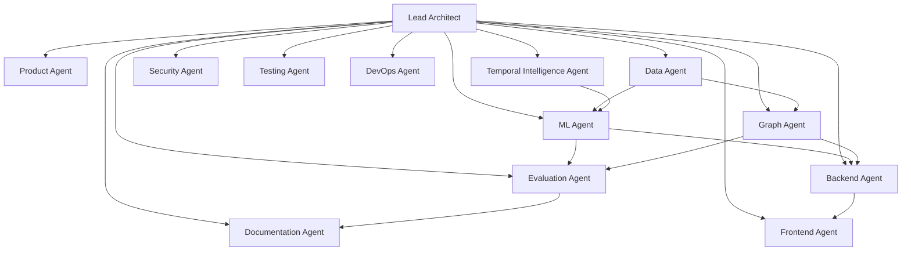

# Agent Organization & Responsibilities

**Status:** Checkpoint 0 — specification.
**Purpose.** This project is built by a single developer wearing many hats. To
keep the work disciplined, responsibilities are organised as thirteen internal
*roles* ("agents"). Each role has a clear remit, defined inputs and outputs, the
roles it depends on, and — most importantly — explicit verification criteria that
say when its work is trustworthy.

This is an organisational device, not a claim that autonomous software agents run
the pipeline. The detection system itself is deterministic ML and graph analytics;
the only LLM component is the late-stage Copilot, which summarises evidence and
never decides fraud.

---

## Role map

---

## 1. Lead Architect

**Responsibilities.** Owns the overall design, the checkpoint sequence, and the
enforcement of the non-negotiable rules (point-in-time safety, sealed held-out
set, no fabricated metrics, human-in-the-loop). Arbitrates cross-role trade-offs
and guards against scope creep and unearned complexity.
**Inputs.** The project specification; the state of each checkpoint.
**Outputs.** `ARCHITECTURE.md`, `ROADMAP.md`, checkpoint reports, design decisions.
**Depends on.** Every role (integrative).
**Verification.** Each checkpoint has explicit exit criteria that are met before
the next begins; no rule in `CONTRIBUTING.md` is silently violated; complexity
additions carry written justification.

## 2. Product Agent

**Responsibilities.** Owns the problem framing, user roles, functional
requirements, and the human-decision boundary. Keeps the build anchored to the
detection thesis rather than to technology for its own sake.
**Inputs.** Specification; user-role needs.
**Outputs.** `PRD.md`.
**Depends on.** Lead Architect.
**Verification.** Every functional requirement has an acceptance criterion; each
UI screen traces to a user job; limitations are documented up front.

## 3. Data Agent

**Responsibilities.** Owns the synthetic ecosystem generator, the seven attack
families, the ground-truth registry, and the temporal split. Ensures normal
behaviour is non-trivial and legitimate sharing exists. Guarantees determinism.
**Inputs.** Config (seed, prevalence, entity counts, attack parameters).
**Outputs.** `simulator/` (Checkpoint 1), `DATA_DICTIONARY.md`, generated datasets,
ground truth, split boundaries.
**Depends on.** Lead Architect, Product Agent.
**Verification.** Same seed + config → byte-identical dataset; readiness audit
passes (`docs/ML_READINESS.md`); naive rules are weak; attacks appear in all
splits; no giveaway artifact.

## 4. ML Agent

**Responsibilities.** Owns point-in-time features, the feature registry,
preprocessing, and the baseline model ladder (majority, logistic regression,
XGBoost). Enforces train-only fitting and validation-only threshold selection.
**Inputs.** Generated datasets and splits; the feature specification.
**Outputs.** `ml/features.py`, `ml/feature_registry.py`, `ml/preprocessing.py`,
model training code (Checkpoint 2), `docs/FEATURE_REFERENCE.md`,
`docs/MODEL_BASELINES.md`, `MODEL_CARD.md`.
**Depends on.** Data Agent, Temporal Intelligence Agent.
**Verification.** All leakage tests pass; no feature emits `NaN`/`inf`;
preprocessing fit on train only; `scale_pos_weight` from train only; every feature
registered with full provenance.

## 5. Temporal Intelligence Agent

**Responsibilities.** Owns rolling-window anomaly detection (15m/1h/6h on counts
and volumes) and robust z-score computation with zero-std, insufficient-history,
and cold-start handling.
**Inputs.** Account transaction history (as-of `T`).
**Outputs.** `ml/temporal.py`, the temporal feature group.
**Depends on.** Data Agent, ML Agent.
**Verification.** No `NaN`/`inf` under any history length; windows half-open
backward; leakage tests pass for temporal features.

## 6. Graph Agent

**Responsibilities.** Owns the heterogeneous NetworkX graph, its metrics (degree,
weighted degree, shared-infrastructure concentration, communities, centrality,
cycles, density), the `graph_risk_score`, and countable graph evidence. Also owns
the entity reputation engine. Critically, builds the scoring graph **as-of `T`**.
**Inputs.** Entities, transactions, derived relationships (as-of `T`).
**Outputs.** `graph/` (Checkpoint 3), graph scores and evidence, reputation scores.
**Depends on.** Data Agent.
**Verification.** Scoring graph uses only edges with `ts < T` (leakage test);
reputation uses only prior confirmed outcomes; every evidence item is countable and
maps to a real graph finding; legitimate sharing does not trivially trigger
detection.

## 7. Backend Agent

**Responsibilities.** Owns the FastAPI application, the layered
router/service/repository structure, SQLAlchemy models, Pydantic schemas, Alembic
migrations, and the alert→case→feedback lifecycle. Calls the intelligence packages
without embedding their logic.
**Inputs.** ML and graph outputs; the database schema.
**Outputs.** `backend/` (Checkpoint 4), REST API, migrations.
**Depends on.** ML Agent, Graph Agent.
**Verification.** API tests pass; all queries go through the ORM (no string SQL);
input validated at the boundary; state transitions audit-logged; risk fusion stores
component scores separately.

## 8. Frontend Agent

**Responsibilities.** Owns the seven-screen React/TypeScript dashboard, including
the Cytoscape graph explorer and the simulation and investigation workflows. Keeps
the typed API client in sync with backend schemas.
**Inputs.** The backend API contract.
**Outputs.** `frontend/` (Checkpoint 5).
**Depends on.** Backend Agent.
**Verification.** Frontend tests pass; every screen traces to a user job; only
measured metrics are displayed on the evaluation screen; no evidence rendered
without a backing signal.

## 9. Evaluation Agent

**Responsibilities.** Owns metric definitions, the four evaluation levels
(transaction/entity/ring/temporal), the cost model, threshold selection, the
ablation study, and the sealed held-out protocol. Ensures Class A and Class B are
reported separately.
**Inputs.** Model and graph outputs; ground truth (evaluation-only).
**Outputs.** `ml/evaluation.py`, `ml/cost.py` (Checkpoint 2), `EVALUATION.md`,
`docs/COST_MODEL.md`, `docs/EXPERIMENT_PROTOCOL.md`, final results (Checkpoint 6).
**Depends on.** ML Agent, Graph Agent, Data Agent.
**Verification.** No metric reported without split/seed/threshold/cost/caveat;
held-out opened once; no fabricated numbers; ring definitions declared and swept.

## 10. Security Agent

**Responsibilities.** Owns env-var configuration, CORS policy, input validation,
ORM-mediated queries, authorization, audit logging, safe error messages, rate
limiting, and secret hygiene.
**Inputs.** The backend application.
**Outputs.** Security configuration and review (Checkpoint 7).
**Depends on.** Backend Agent, DevOps Agent.
**Verification.** No secrets in source; `.env` gitignored; CORS restricted;
parameterised queries only; consequential actions audit-logged; generic error
messages externally.

## 11. Testing Agent

**Responsibilities.** Owns the full test taxonomy — unit, integration, API, ML,
leakage, graph, frontend, e2e — and the invariant that `uv run pytest` passes
before a checkpoint completes. Guards the leakage suite against being weakened.
**Inputs.** Every component.
**Outputs.** `tests/` across all suites.
**Depends on.** All implementation roles.
**Verification.** `uv run pytest` green at each checkpoint; leakage tests never
skipped/xfailed/deleted; coverage tracked on core packages.

## 12. DevOps Agent

**Responsibilities.** Owns packaging (uv), Docker and docker-compose, CI/CD, the
`.env.example` contract, and reproducible environments.
**Inputs.** The full application.
**Outputs.** `Dockerfile`, `docker-compose.yml`, `.github/workflows/`,
`pyproject.toml`, `Makefile` (Checkpoint 7; config scaffolded in Checkpoint 0).
**Depends on.** Backend, Frontend, Security Agents.
**Verification.** Clean checkout builds and runs via compose; CI runs lint + types
+ tests + the held-out-access guard; no credentials committed.

## 13. Documentation Agent

**Responsibilities.** Owns documentation coherence, the README, the diagrams, the
honesty of every claim, and the resume artifacts. Ensures unmeasured quantities
read "Not yet measured."
**Inputs.** Every role's outputs.
**Outputs.** `README.md`, `docs/RESUME_BULLETS.md` (Checkpoint 8), diagram upkeep,
cross-reference integrity.
**Depends on.** All roles.
**Verification.** No fabricated metrics anywhere; diagrams match the
implementation; every doc cross-references correctly; limitations documented before
a reviewer finds them.

---

## Cross-cutting rules every role obeys

Regardless of role, the following always hold (full text in `CONTRIBUTING.md`):

1. Synthetic data only; no real PII.
2. No fabricated metrics — "Not yet measured." until an experiment runs.
3. Point-in-time safety; features read only `ts < T`.
4. The held-out set is sealed until Checkpoint 6.
5. Preprocessing fit on train only.
6. No hardcoded fraud decisions.
7. No secrets in source.
8. Evidence maps to a real signal.
9. Humans decide consequential actions.

---

## Related documents

- `ARCHITECTURE.md` — how the roles' outputs fit together
- `PRD.md` — product requirements the roles satisfy
- `ROADMAP.md` — checkpoint sequence the roles execute
- `CONTRIBUTING.md` — the shared engineering rules
