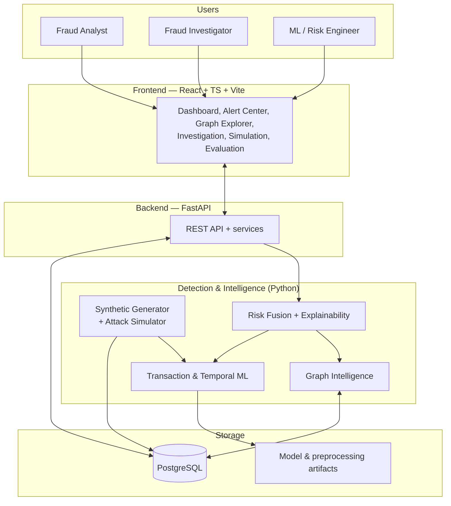
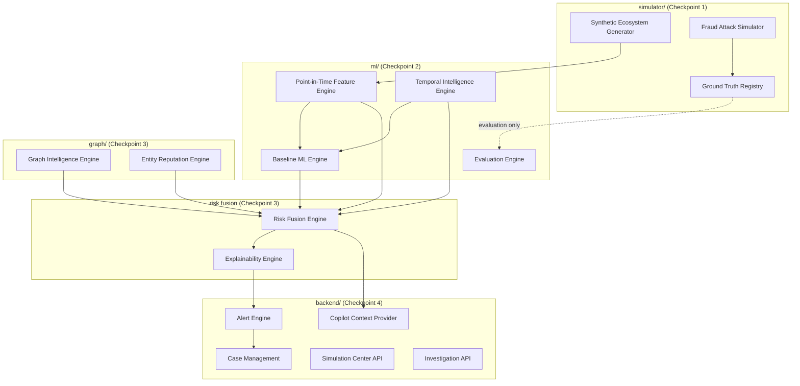
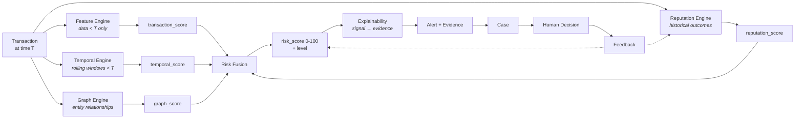
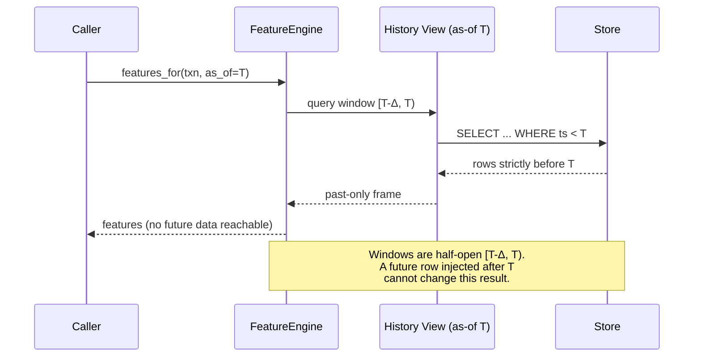
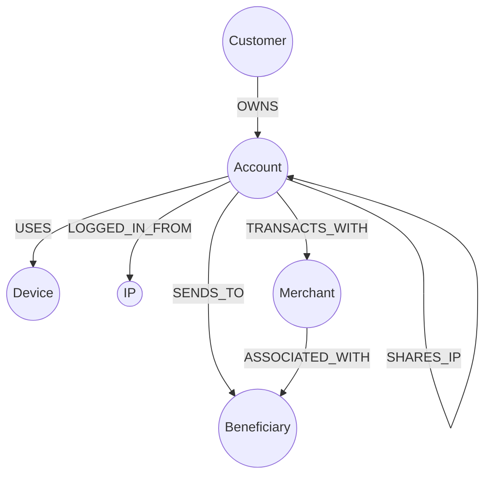
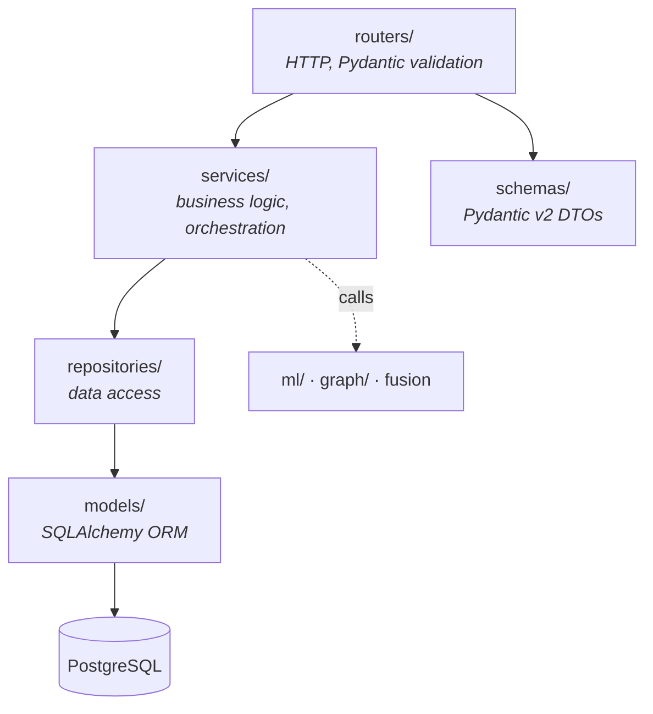
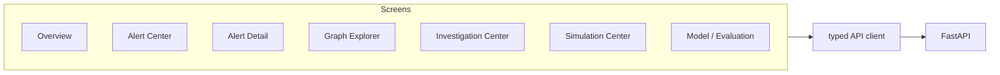
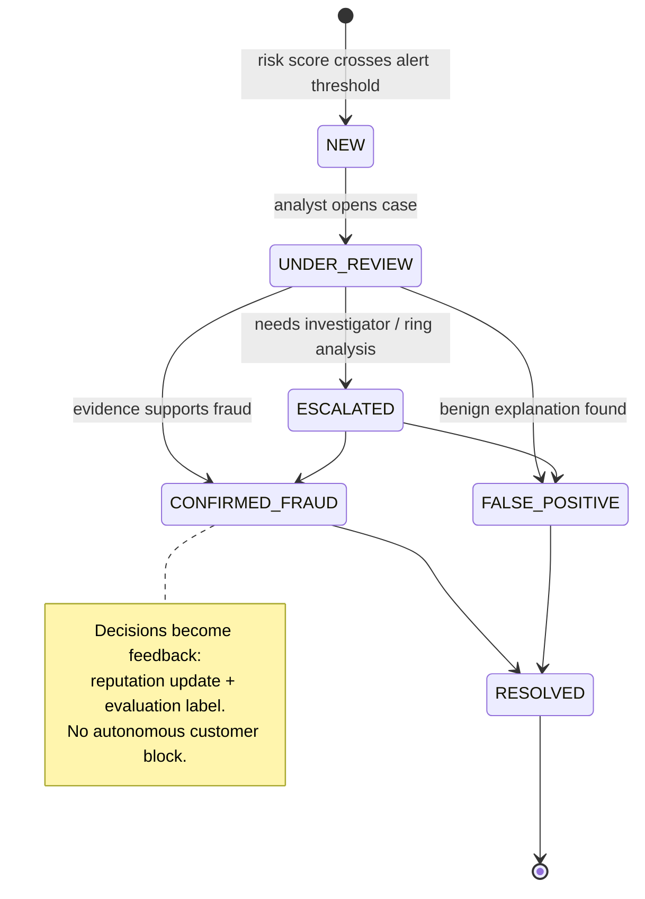
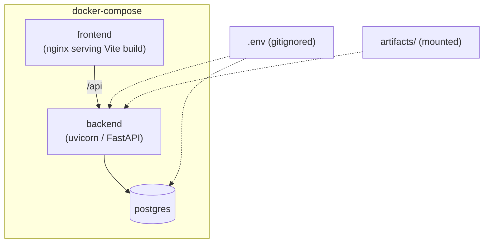

# Architecture — Abuse-Ring Sentinel

**Status:** Checkpoint 0 (Foundation). This document describes the *target*
architecture and the boundaries that are fixed now. Components are built
progressively per `ROADMAP.md`; nothing here implies code exists yet.

> Abuse-Ring Sentinel is a production-*style* portfolio prototype on synthetic
> data. "Production-style" refers to engineering discipline (modularity, tests,
> migrations, containers), not to real-world deployment readiness.

---

## 1. Design principles

The architecture follows a small set of rules that override convenience:

1. **Layered detection, separately scored.** Transaction, temporal, graph, and
   reputation signals are computed by independent engines and stored as separate
   scores. Fusion happens in exactly one place. This is what makes the ablation
   study possible.
2. **Point-in-time correctness is structural, not incidental.** Feature code
   receives an explicit "as-of" time and a repository that can only see the
   past. Leakage is prevented by construction and verified by tests.
3. **Ground truth is quarantined.** It is generated with the data and is
   physically separate from every inference path. No feature, model, or scorer
   imports it.
4. **Determinism is a first-class requirement.** One master seed fans out into
   per-component seeds; the same seed and config reproduce data and experiments
   exactly.
5. **The boundary between "machine suggests" and "human decides" is explicit.**
   The system scores, alerts, explains, and recommends. Consequential action is
   a human transition in the case workflow.
6. **Complexity must be earned.** NetworkX before Neo4j; classical ML before deep
   learning; a monolith-style modular backend before microservices. Each step up
   requires a measured reason.

---

## 2. System context

The intelligence layer is a set of Python packages the backend calls. It is not a
separate network service — a deliberate simplicity choice for a prototype. If a
future need for isolation or independent scaling is demonstrated, the service
boundary already exists at the package level and can be promoted to a process
boundary.

---

## 3. Component architecture

The sixteen product components from the PRD map onto four Python packages plus
the backend and frontend applications.

Package responsibilities:

| Package | Owns | Checkpoint |
|---|---|---|
| `simulator/` | Ecosystem generation, seven attack families, ground truth | 1 |
| `ml/` | Point-in-time features, temporal signals, baseline models, evaluation, cost | 2, 6 |
| `graph/` | Heterogeneous graph, community/cycle/centrality detection, reputation | 3 |
| `backend/` | API, persistence, alerts, cases, simulation orchestration, copilot context | 4 |
| `frontend/` | Seven-screen dashboard incl. Cytoscape graph explorer | 5 |

Risk fusion and explainability live at the seam between `ml/`+`graph/` and the
backend; their pure logic sits in a small module the backend service layer calls,
so it stays unit-testable without a database.

---

## 4. Detection pipeline (data flow)

The four component scores are computed independently and never overwrite each
other. Fusion reads all four, applies configurable weights, and clamps to
`[0, 100]`. Explainability reads the same component outputs and renders evidence;
it cannot invent an evidence item that has no backing signal. Feedback flows back
to reputation and to future evaluation, closing the loop.

---

## 5. Point-in-time safety (the central invariant)

The most important architectural constraint is that features for a transaction at
time `T` depend only on data strictly before `T`.

This is enforced three ways: (1) feature functions take an explicit `as_of`
timestamp and a history view that filters `ts < T`; (2) windows are always
half-open and backward-looking; (3) leakage tests inject future rows and assert
that already-computed features are unchanged. The policy is specified in
`docs/FEATURE_LEAKAGE_POLICY.md`.

---

## 6. Graph model

A single heterogeneous graph carries six node types and typed edges.

| Edge | Meaning |
|---|---|
| `OWNS` | Customer owns account |
| `USES` | Account observed on a device |
| `LOGGED_IN_FROM` | Account observed from an IP |
| `TRANSACTS_WITH` | Account paid a merchant |
| `SENDS_TO` | Account sent funds to a beneficiary |
| `SHARES_DEVICE` | Derived: accounts on a common device |
| `SHARES_IP` | Derived: accounts on a common IP |
| `ASSOCIATED_WITH` | Merchant settles to a beneficiary |

Derived `SHARES_*` edges are materialized above a *normal-sharing baseline*,
because limited legitimate sharing exists by design. The graph engine computes
degree/weighted degree, shared-infrastructure concentration, communities
(Louvain, built into NetworkX ≥3), PageRank/centrality, cycles, and cluster
density, and emits a `graph_risk_score` with countable evidence.

---

## 7. Backend architecture

FastAPI with a layered internal structure. Requests flow through routers →
services → repositories → ORM, so business logic never touches the request or
the raw SQL directly.

Router surfaces: `/transactions`, `/accounts`, `/merchants`, `/devices`,
`/alerts`, `/cases`, `/graph`, `/simulation`, `/evaluation`, `/risk`. Alembic owns
schema migrations. The full table list is in `DATA_DICTIONARY.md`.

Layering rationale: repositories isolate all data access so services stay
testable against fakes; keeping the intelligence packages callable from services
(not embedded in them) preserves the ablation seam and lets ML/graph code be
tested with no web or database stack.

---

## 8. Frontend architecture

React + TypeScript + Vite + Tailwind, Recharts for charts, Cytoscape.js for the
graph explorer, Lucide for icons. A thin typed API client wraps the backend;
screen components stay declarative.

TypeScript types mirror the backend Pydantic schemas so the contract is checked
at compile time on the client and at validation time on the server.

---

## 9. Alert → case → feedback lifecycle

Every transition is written to `audit_logs`. Decisions feed the reputation engine
and the evaluation label store, never the live feature computation for past
transactions.

---

## 10. Technology stack and rationale

| Layer | Choice | Why this, not the alternative |
|---|---|---|
| Frontend | React + TS + Vite + Tailwind | Fast dev loop, typed contract, no CSS framework lock-in |
| Charts | Recharts | Lightweight, declarative; heavy BI libs unnecessary |
| Graph UI | Cytoscape.js | Purpose-built for interactive network exploration |
| Backend | FastAPI + Pydantic v2 | Async, typed, auto OpenAPI; validation at the edge |
| ORM | SQLAlchemy 2.0 + Alembic | Mature, parameterized queries, real migrations |
| DB | PostgreSQL (SQLite for quick local dev) | Relational fits entities/edges; JSONB for evidence |
| ML | scikit-learn + XGBoost | Strong tabular baselines; interpretable; no GPU needed |
| Graph | NetworkX | Sufficient at prototype scale; Louvain built in |
| Packaging | uv | Fast, reproducible, single lockfile |
| Runtime | Docker + docker-compose | Reproducible full stack |

Deliberately excluded until measured need: Neo4j, graph neural networks, deep
learning for tabular data, Kafka/Spark/streaming, a service mesh, and any managed
cloud infrastructure. The reasoning for each exclusion is recorded in
`docs/ML_READINESS.md` and `CONTRIBUTING.md`.

---

## 11. Deployment topology (target)

Three services: frontend, backend, postgres. Model and preprocessing artifacts
are built or mounted separately, not baked into the image, so the container does
not carry large binaries. Configuration is entirely environment-driven;
`.env.example` documents every variable and `.env` is never committed.

---

## 12. Cross-cutting concerns

**Security.** Env-var configuration, explicit CORS allow-list, Pydantic input
validation at every boundary, ORM-parameterized queries (no string SQL),
authorization on state-changing routes, audit logging of decisions, safe generic
error messages, and rate limiting where practical. Detailed in the Checkpoint 7
security review.

**Observability / monitoring (lightweight).** Model version, prediction
distribution, feature drift, latency, and error rate — enough to detect drift and
regressions, not a full enterprise stack.

**Reproducibility.** Master seed → per-component seeds; configs and seeds recorded
with every experiment per `docs/EXPERIMENT_PROTOCOL.md`.

**Testing.** Unit, integration, API, ML, leakage, graph, frontend, and e2e
suites. Leakage tests are load-bearing and never skipped. `uv run pytest` must
pass before a checkpoint is complete.

---

## 13. What is intentionally NOT in the architecture

- No autonomous blocking or account action.
- No real-time streaming ingestion.
- No microservices; the intelligence layer is in-process Python packages.
- No feature store, model registry service, or orchestration platform.
- No LLM anywhere in the scoring path; the Copilot only summarizes existing
  evidence and is added last.

Each omission is a deliberate scope decision to keep the prototype legible and
its results defensible, not an oversight.
