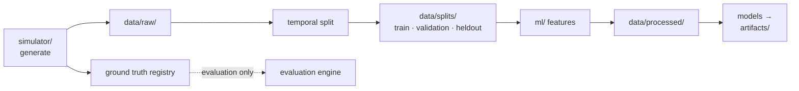

# Data Dictionary

**Status:** Checkpoint 0 — specification. Entities are implemented in Checkpoint 1,
database tables in Checkpoint 4.
**Owner:** Data Agent (see `AGENTS.md`)

**Purpose.** Define every entity, transaction field, ground-truth record, and
database table in the system.

> **All data in this system is synthetic.** No real customer data, no real
> financial records, and no real PII exist anywhere in the pipeline. Names,
> addresses, and identifiers are generated. Nothing here describes a real person
> or institution.

---

## 1. Conventions

Rules that hold across every entity:

- **Stable unique IDs.** Every entity has a unique, stable, non-sequential-looking
  identifier with a type prefix (`cust_`, `mer_`, `acc_`, `dev_`, `ip_`, `ben_`,
  `txn_`). Prefixes make IDs self-describing in logs, graphs, and UI.
- **Creation timestamps.** Every entity records when it came into existence. This
  drives `account_age_days` and synthetic-identity-cluster detection.
- **No real PII.** Generated attributes are synthetic tokens. Device fingerprints
  and IPs are fabricated; IPs are drawn from documentation/reserved ranges so they
  can never correspond to a real host.
- **Timezone.** All timestamps are UTC.
- **Determinism.** Everything derives from the master seed.

---

## 2. Entities

### 2.1 Customer

A synthetic person who owns one or more accounts.

| Field | Type | Description |
|---|---|---|
| `customer_id` | str | Unique ID, `cust_` prefixed |
| `created_at` | datetime | Registration time |
| `country` | str | Synthetic country code |
| `region` | str | Synthetic region within country |
| `home_lat` | float | Home latitude (geography features) |
| `home_lon` | float | Home longitude |
| `segment` | str | Behavioural segment (e.g. low/medium/high activity) |
| `spending_profile` | str | Drives amount distribution parameters |
| `risk_band` | str | Generator-side behavioural band (**not** a fraud label) |
| `is_synthetic_identity` | bool | Ground-truth marker; quarantined from features |

### 2.2 Merchant

A synthetic business receiving payments.

| Field | Type | Description |
|---|---|---|
| `merchant_id` | str | Unique ID, `mer_` prefixed |
| `created_at` | datetime | Onboarding time |
| `category` | str | Merchant category (retail, travel, digital goods, …) |
| `country` | str | Registered country |
| `lat` / `lon` | float | Location |
| `size_tier` | str | Volume tier — small/medium/large, drives transaction counts |
| `avg_ticket_size` | float | Typical transaction amount |
| `is_fake` | bool | Ground-truth marker; quarantined from features |

### 2.3 Account

A payment account owned by a customer. The primary subject of behavioural features.

| Field | Type | Description |
|---|---|---|
| `account_id` | str | Unique ID, `acc_` prefixed |
| `customer_id` | str | FK → Customer |
| `created_at` | datetime | Account opening time; drives `account_age_days` |
| `account_type` | str | e.g. checking, savings, wallet |
| `status` | str | active / dormant / closed |
| `baseline_tx_frequency` | float | Expected transactions per day |
| `baseline_amount_mean` | float | Expected amount centre |
| `baseline_amount_std` | float | Expected amount spread |

### 2.4 Device

A device fingerprint. Central to shared-device ring detection.

| Field | Type | Description |
|---|---|---|
| `device_id` | str | Unique ID, `dev_` prefixed |
| `created_at` | datetime | First observation |
| `device_type` | str | mobile / desktop / tablet |
| `os_family` | str | Synthetic OS family |
| `fingerprint_hash` | str | Synthetic fingerprint token |
| `is_shared_legitimate` | bool | Ground-truth marker for benign sharing (household/shared machine) |

Benign sharing exists by design: without it, "shared device ⇒ fraud" would be
trivially true and the graph benchmark meaningless (see `docs/ML_READINESS.md`).

### 2.5 IP Address

| Field | Type | Description |
|---|---|---|
| `ip_id` | str | Unique ID, `ip_` prefixed |
| `created_at` | datetime | First observation |
| `ip_address` | str | Synthetic address from reserved/documentation ranges |
| `country` / `region` | str | Geolocation |
| `lat` / `lon` | float | Approximate coordinates |
| `ip_type` | str | residential / mobile / datacenter / vpn |
| `is_shared_legitimate` | bool | Benign sharing marker (NAT / CGNAT / corporate egress) |

### 2.6 Beneficiary

A payout destination. Key to fake merchant rings and circular flows.

| Field | Type | Description |
|---|---|---|
| `beneficiary_id` | str | Unique ID, `ben_` prefixed |
| `created_at` | datetime | Registration time |
| `beneficiary_type` | str | individual / business |
| `country` | str | Country |
| `linked_account_id` | str \| null | Optional FK → Account (enables cycles) |

---

## 3. Transaction

The central fact table. One row per payment event.

| Field | Type | Description |
|---|---|---|
| `transaction_id` | str | Unique ID, `txn_` prefixed |
| `timestamp` | datetime | Event time (UTC). Drives all point-in-time logic |
| `account_id` | str | FK → Account (payer) |
| `customer_id` | str | FK → Customer (denormalised) |
| `merchant_id` | str \| null | FK → Merchant, when merchant-directed |
| `beneficiary_id` | str \| null | FK → Beneficiary, when a transfer |
| `device_id` | str | FK → Device used |
| `ip_id` | str | FK → IP used |
| `amount` | float | Transaction amount |
| `currency` | str | Currency code |
| `channel` | str | web / mobile / pos / api |
| `transaction_type` | str | purchase / transfer / withdrawal / refund |
| `lat` / `lon` | float | Transaction location (geography features) |
| `status` | str | completed / pending / failed |
| `is_fraud` | bool | **Ground-truth label — evaluation only, quarantined** |
| `attack_id` | str \| null | **Ground truth — links to the attack that generated it** |

`is_fraud` and `attack_id` are physically present in the generated dataset but are
never readable by feature, model, scoring, or graph-scoring code. Enforcement is
described in `docs/FEATURE_LEAKAGE_POLICY.md` §4.

---

## 4. Ground truth registry

The authoritative record of what actually happened. Written by the simulator,
consumed only by the evaluation engine.

| Field | Type | Description |
|---|---|---|
| `attack_id` | str | Unique attack identifier |
| `attack_type` | str | One of the seven families (§5) |
| `start_time` | datetime | Attack onset — the reference for detection latency |
| `end_time` | datetime | Attack conclusion |
| `severity` | str | Generator-assigned severity |
| `generation_parameters` | json | Full parameter set used, for reproducibility |
| `affected_transaction_ids` | list[str] | Transaction-level truth |
| `affected_customer_ids` | list[str] | Entity-level truth |
| `affected_merchant_ids` | list[str] | Entity-level truth |
| `affected_account_ids` | list[str] | Entity-level truth |
| `affected_device_ids` | list[str] | Entity-level truth |
| `affected_ip_ids` | list[str] | Entity-level truth |
| `affected_beneficiary_ids` | list[str] | Entity-level truth |

These fields support all four evaluation levels: transaction (affected
transactions), entity (affected `*_ids`), ring (the entity set as a group), and
temporal (`start_time` vs first alert). See `EVALUATION.md`.

---

## 5. Attack families

Seven parameterized families. Parameters are illustrative of *shape*; exact values
are configurable and vary by split per `docs/DATA_SPLIT_PROTOCOL.md` §6.

| Family | Module | Key parameters |
|---|---|---|
| Fake Merchant Ring | `attacks/fake_merchant_ring.py` | merchants, accounts, devices, duration_hours, intensity |
| Shared Device Ring | `attacks/shared_device_ring.py` | accounts, devices, sharing_density, duration_hours |
| Transaction Spike | `attacks/transaction_spike.py` | multiplier, duration_hours, target_entity |
| Circular Money Flow | `attacks/circular_money_flow.py` | cycle_length, amount, rounds, duration_hours |
| Synthetic Identity Cluster | `attacks/synthetic_identity_cluster.py` | identities, creation_window, attribute_correlation |
| Coordinated Microtransactions | `attacks/microtransaction_attack.py` | accounts, tx_per_account, amount_range, duration_hours |
| Account Takeover | `attacks/account_takeover.py` | target_account, new_device, geo_jump_km, velocity_multiplier, duration_hours |

No attack shape is hardcoded; each exposes a typed parameter object, and identical
seed plus parameters reproduce identical output.

---

## 6. Database schema (Checkpoint 4)

PostgreSQL tables, grouped by purpose.

### Entity and transaction tables

| Table | Contents |
|---|---|
| `customers` | §2.1 |
| `merchants` | §2.2 |
| `accounts` | §2.3 |
| `devices` | §2.4 |
| `ips` | §2.5 |
| `beneficiaries` | §2.6 |
| `transactions` | §3 |

### Detection and alerting

| Table | Contents |
|---|---|
| `risk_scores` | Fused score plus the four component scores, per transaction, with model version |
| `alerts` | Alert records, risk level, status, timestamps |
| `alert_evidence` | Individual evidence items, each referencing its backing signal |

### Investigation workflow

| Table | Contents |
|---|---|
| `cases` | Case records and lifecycle status |
| `case_notes` | Investigator notes |
| `case_decisions` | Decision history (confirmed fraud / false positive / escalated) |
| `feedback` | Decisions fed back to reputation and evaluation |

### Graph

| Table | Contents |
|---|---|
| `graph_entities` | Materialised graph nodes with type and computed metrics |
| `graph_relationships` | Typed edges with weights and first/last-seen timestamps |

### Simulation and models

| Table | Contents |
|---|---|
| `simulations` | Simulation runs launched from the UI |
| `simulation_attacks` | Attacks within a run, with parameters and ground truth |
| `model_versions` | Registered model versions and metadata |

### Audit

| Table | Contents |
|---|---|
| `audit_logs` | Every state transition and consequential action, with actor and timestamp |

### Indexing strategy

Indexes are added where access patterns demand them, not speculatively:

- `transactions (timestamp)` — every point-in-time window query filters on time
- `transactions (account_id, timestamp)` — the dominant feature-computation pattern
- `transactions (merchant_id, timestamp)`, `(device_id, timestamp)`,
  `(ip_id, timestamp)` — entity history lookups
- `alerts (status, risk_level, created_at)` — Alert Center filtering and sorting
- `graph_relationships (source_id)`, `(target_id)`, `(relationship_type)` — graph
  traversal and expansion
- `risk_scores (transaction_id)` — alert detail joins
- `audit_logs (entity_id, created_at)` — audit trail retrieval

Composite `(entity, timestamp)` indexes matter most: they serve exactly the
`WHERE entity = ? AND ts < T` query that every point-in-time feature performs.

---

## 7. Data lifecycle

Generated data and artifacts are **not** committed to version control (see
`.gitignore`). Datasets are reproduced from a seed and config via
`scripts/generate_dataset.py`, which keeps the repository small and reproducibility
explicit.

---

## Related documents

- `docs/FEATURE_REFERENCE.md` — features derived from these fields
- `docs/FEATURE_LEAKAGE_POLICY.md` — ground-truth quarantine rules
- `docs/DATA_SPLIT_PROTOCOL.md` — how transactions are partitioned
- `docs/ML_READINESS.md` — data integrity audit
- `EVALUATION.md` — how ground truth is consumed
- `ARCHITECTURE.md` — graph model and backend layering
