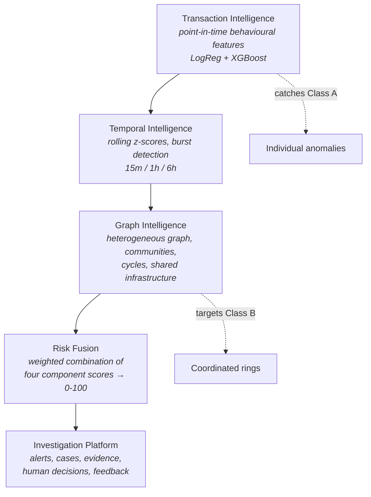

# Product Requirements Document — Abuse-Ring Sentinel

**Subtitle:** Graph-Based Fraud Intelligence & Coordinated Abuse Detection Platform
**Status:** Checkpoint 0 (Foundation) — specification only, no empirical results yet
**Document owner:** Product Agent (see `AGENTS.md`)
**Last updated:** 2026-08-24

> **Scope disclaimer.** Abuse-Ring Sentinel is a *research / portfolio fraud
> intelligence platform* built entirely on synthetic data. It is a
> production-*style* prototype. It is not certified, validated, or suitable for
> use in a real banking or payments environment, and no claim in this document
> should be read as a statement about real-world fraud rates or real financial
> losses.

---

## 1. Problem statement

Fraud detection systems built around individual transactions share a structural
blind spot. A model that scores one transaction at a time asks: *does this
payment look unusual for this customer?* That question catches a stolen card
being used for an atypical purchase. It systematically under-serves a second,
economically significant class of abuse in which **no single transaction looks
unusual at all**.

Consider a fake-merchant ring. Twelve merchant accounts are registered over
three weeks. Each processes a modest, plausible volume of small payments. Each
individual transaction sits comfortably inside a normal amount distribution.
Nothing triggers a velocity rule. Viewed as 4,000 independent rows, the activity
is unremarkable.

Viewed as a graph, it is obvious: all twelve merchants settle to three shared
beneficiary accounts, were registered from two device fingerprints, and their
payer accounts overlap heavily. The signal does not live in any transaction. It
lives in the **relationships between entities**.

### The product thesis

> Individual transaction models can identify suspicious transactions, but
> coordinated fraud often requires understanding the relationships between
> entities.

This project's purpose is to build that argument empirically — to construct a
system where transaction-level ML is implemented honestly and well, to measure
where it succeeds and where it fails, and then to demonstrate whether graph
intelligence closes the gap on coordinated abuse.

A corollary matters just as much: **we want to discover the limitations of
transaction-level ML, not hide them.** A tuned XGBoost model that scores well on
individual anomalies and poorly on rings is not a failure of the project. It is
the project's central finding, and the ablation study in Checkpoint 6 exists to
measure exactly that.

---

## 2. Goals and non-goals

### Goals

| # | Goal | How it is verified |
|---|------|--------------------|
| G1 | Generate a synthetic financial ecosystem whose *normal* behaviour is non-trivial and whose fraud is not detectable by a single threshold | Distribution checks + a "large amount = fraud" rule must perform poorly (Checkpoint 1.5) |
| G2 | Detect individual/transaction anomalies with calibrated, cost-aware ML | PR-AUC, precision, recall, total error cost on validation → held-out (Checkpoints 2, 6) |
| G3 | Detect coordinated abuse rings that transaction ML misses | Entity-level and ring-level precision/recall/F1 (Checkpoints 3, 6) |
| G4 | Fuse multiple independent signals into one explainable 0–100 risk score | Component scores stored separately and reproducible from stored evidence (Checkpoint 3) |
| G5 | Make every alert explainable, with evidence traceable to a real signal | Every evidence item references a feature, model attribution, or graph finding (Checkpoint 3) |
| G6 | Support a real investigation workflow with human decisions | Alert → case → decision → feedback lifecycle persisted and auditable (Checkpoints 4, 5) |
| G7 | Let a user generate a synthetic attack from the UI and compare detection against ground truth | Simulation Center round-trip: configure → generate → detect → compare (Checkpoint 5) |
| G8 | Produce a defensible, leakage-free evaluation | Automated leakage tests; sealed held-out set opened once (Checkpoints 1.5, 6) |

### Non-goals

- **Real-money decisioning.** The system never autonomously blocks a customer.
- **Real data of any kind.** No real transactions, customers, or PII, ever.
- **Regulatory compliance.** No AML/KYC/PCI-DSS certification is claimed.
- **Beating a published benchmark.** Results are on synthetic data and are not
  comparable to public fraud datasets or to production systems.
- **Maximum model complexity.** Deep learning and graph neural networks are
  explicitly out of scope unless simpler approaches are first implemented,
  measured, and shown insufficient.
- **Distributed/streaming infrastructure.** No Kafka, Spark, or microservice
  mesh. Complexity must be earned.

---

## 3. Users and use cases

The platform models three roles. All three are served by the same deployment;
role separation drives what each screen emphasises.

### 3.1 Fraud Analyst (primary)

Works a queue. Needs to triage many alerts quickly and correctly.

**Core job:** open the highest-risk alert, understand in under a minute *why* it
fired, decide, and move on.

- Sees the Alert Center sorted by risk with filters for risk level, attack type,
  date, and status.
- Opens Alert Detail: a 0–100 score, its four component contributions, and a
  ranked evidence list in plain language.
- Escalates when the evidence points beyond a single account.
- Records a decision — confirmed fraud, false positive, or escalate — which
  becomes feedback.

**Success:** the analyst rarely needs to leave the alert to understand it.

### 3.2 Fraud Investigator (graph-centric)

Handles escalations and suspected rings. Needs to see structure.

**Core job:** determine whether an alert is an isolated incident or the visible
edge of a coordinated ring, and establish its full extent.

- Opens the Graph Explorer from an alert, expands neighbours, and follows shared
  devices, IPs, and beneficiaries.
- Inspects detected communities, circular money paths, and shared-infrastructure
  findings.
- Builds a case covering many entities and transactions, with notes and a
  decision history.

**Success:** the investigator can enumerate the ring's members and articulate the
relationship that connects them.

### 3.3 ML / Risk Engineer (evaluation-centric)

Owns detection quality. Needs measurement, not vibes.

**Core job:** understand where detection works, where it fails, and what a
threshold change costs.

- Reviews the Model/Evaluation screen: real metrics from executed runs, per
  split, per model version.
- Reads the ablation study (transaction → +temporal → +graph → +reputation).
- Uses the cost curve to choose an operating threshold on validation data.
- Runs the Simulation Center against novel attack parameters to probe
  generalization.

**Success:** every claimed improvement is attributable to a specific component
and reproducible from a seed.

---

## 4. What the system detects

Two fundamentally different classes, deliberately kept separate until fusion.

### Class A — Individual / transaction anomalies

Detectable, in principle, from one transaction plus that entity's own history.

| Pattern | Signal that should catch it |
|---|---|
| Unusual transaction amount | Amount deviation from the account's historical distribution |
| Unusual velocity | Transaction counts over 15m / 1h / 6h / 24h / 7d windows |
| Abnormal customer behaviour | Frequency and amount deviation from personal baseline |
| Impossible travel | Geographic distance ÷ elapsed time exceeding a feasible speed |
| Unusual beneficiary | First-time or rare beneficiary for this account |
| Account takeover behaviour | Simultaneous change in device, IP, geography, and velocity |
| Temporal spikes | Rolling z-scores on counts and volumes |

### Class B — Coordinated abuse

Generally **not** detectable from a single transaction, because each transaction
is individually plausible.

| Pattern | Signal that should catch it |
|---|---|
| Fake merchant rings | Merchants linked through shared devices, IPs, beneficiaries, accounts |
| Shared-device networks | Many accounts concentrated on few device fingerprints |
| Shared-IP networks | Same, for IP addresses, above a normal-sharing baseline |
| Synthetic identity clusters | Correlated account creation timing and attribute similarity |
| Circular money movement | Cycle detection in the money-flow graph (A → B → C → A) |
| Coordinated microtransactions | Many small payments that only look wrong in aggregate |
| Suspicious entity communities | Dense communities with abnormal internal edge ratios |

The evaluation is designed so that Class B performance can be reported
separately. Aggregate metrics that average across both classes would hide the
exact effect this project exists to measure.

---

## 5. Capability progression

The system is built as five layers, each earning its place by measurement.

Each arrow is a hypothesis to be tested, not an assumption. If adding temporal
features does not improve detection, that result is reported as-is.

---

## 6. Functional requirements

### FR-1 Synthetic ecosystem generation

Generate customers, merchants, accounts, devices, IPs, beneficiaries, and
transactions with stable unique IDs and creation timestamps.

Normal behaviour must include heterogeneous merchant volumes, per-customer
spending profiles, legitimate high-value outliers, limited *legitimate* device
and IP sharing (households, shared computers, NAT/CGNAT), varied transaction
frequencies, and realistic hour-of-day / day-of-week seasonality.

**Acceptance:** neither "large amount ⇒ fraud" nor "high count ⇒ fraud" is a
strong classifier. Legitimate sharing exists, so shared infrastructure alone
cannot be treated as proof of abuse.

### FR-2 Parameterized attack simulation

Seven attack families, each fully parameterized — no hardcoded attack shapes.
Fake merchant ring, shared device ring, transaction spike, circular money flow,
synthetic identity cluster, coordinated microtransactions, account takeover.

**Acceptance:** each attack exposes a typed parameter object; two runs with the
same seed and parameters are byte-identical; changing a parameter measurably
changes the generated data.

### FR-3 Ground truth registry

An authoritative record per attack: ID, type, start/end time, severity,
generation parameters, and the affected transaction, customer, merchant, account,
device, IP, and beneficiary IDs.

**Acceptance:** supports transaction-level, entity-level, ring-level, and
temporal (detection-latency) evaluation. Never consulted by any feature,
model, or scoring path.

### FR-4 Point-in-time feature engine

Behavioural features computed under a strict rule: for a transaction at time `T`,
only data with timestamp `< T` may be used. Windows are half-open and
backward-looking, `[T - Δ, T)`.

**Acceptance:** automated leakage tests pass — injecting future transactions,
amounts, or entity statistics must not change any already-computed feature. No
uncontrolled NaN or inf; cold start is handled explicitly.

### FR-5 Temporal intelligence

Rolling-window anomaly detection at 15m, 1h, and 6h on counts and volumes, with
z-scores computed from historical statistics only. Zero standard deviation,
insufficient history, and cold start are handled without NaN or inf.

### FR-6 Baseline ML

Model 0 majority classifier, Model 1 logistic regression, Model 2 XGBoost.
Preprocessing fit on train only. Class ratio (`scale_pos_weight`) computed from
train only. Threshold selected on validation only, by minimising total error
cost.

### FR-7 Graph intelligence

Heterogeneous NetworkX graph over six node types with typed edges. Computes
degree and weighted degree, shared-infrastructure concentration, community
structure, PageRank/centrality, cycles, and cluster density. Emits a
`graph_risk_score` plus human-readable, countable evidence.

### FR-8 Entity reputation

Historical risk scores for merchants, accounts, devices, IPs, and beneficiaries,
derived from confirmed historical outcomes only — never future outcomes, never
ground truth at scoring time.

### FR-9 Risk fusion

Combine transaction, temporal, graph, and reputation scores into a 0–100 risk
score with configurable weights. Component scores persist independently.

### FR-10 Risk levels and actions

LOW → allow. MEDIUM → monitor. HIGH → enhanced verification / human review.
CRITICAL → human review / temporary hold.

**Hard constraint:** no autonomous customer blocking on model output alone.

### FR-11 Explainability

Every alert answers "why was this flagged?" in plain language, with each item
mapped to a concrete feature value, model attribution, or graph finding.

**Acceptance:** no evidence string can be produced without a backing signal.

### FR-12 Alert, case, and feedback lifecycle

`TRANSACTION → RISK SCORE → ALERT → CASE → INVESTIGATION → DECISION → FEEDBACK`,
with statuses NEW, UNDER_REVIEW, CONFIRMED_FRAUD, FALSE_POSITIVE, ESCALATED,
RESOLVED. All transitions audit-logged.

### FR-13 REST API

FastAPI over PostgreSQL covering transactions, accounts, merchants, devices,
alerts, cases, graph, simulation, evaluation, and risk. Pydantic v2 validation,
SQLAlchemy ORM, Alembic migrations.

### FR-14 React dashboard

Seven screens: Overview, Alert Center, Alert Detail, Graph Explorer (Cytoscape),
Investigation Center, Simulation Center, Model/Evaluation. Not a generic admin
template.

### FR-15 Simulation Center

From the UI: choose attack type and parameters → generate → run detection →
visualize the ring → compare detected entities against ground truth.

### FR-16 Evaluation engine

Transaction-level, entity-level, ring-level, and temporal-latency metrics, plus
cost-sensitive analysis and the four-way ablation study.

### FR-17 AI Investigation Copilot (late stage)

Receives structured context (alert, risk score, features, graph evidence,
transaction history, case notes, model explanation) and summarizes it.

**Hard constraints:** must not independently determine fraud; must not
recommend blocking; must not invent facts. With no LLM configured, ships a
context provider plus a deterministic mock rather than faked output.

---

## 7. Non-functional requirements

| Area | Requirement |
|---|---|
| Reproducibility | A seed plus a config reproduces any dataset and experiment exactly |
| Explainability | No unexplainable alert reaches an analyst |
| Modularity | Detection layers are independently testable and separately scored |
| Testability | `uv run pytest` green before any checkpoint is called complete |
| Security | Env-var config, CORS policy, input validation, ORM-mediated queries, authorization, audit logs, safe error messages, no secrets in source |
| Honesty | Unmeasured quantities are written as "Not yet measured." |
| Simplicity | New dependencies and new infrastructure require written justification |

Latency and throughput targets are deliberately **not** specified at Checkpoint
0. Setting a number before measuring anything would be inventing a requirement.
Targets will be set from a measured baseline in Checkpoint 6.

---

## 8. Benchmark configuration

Fraud prevalence is configurable; 1%, 5%, 10%, and 25% are supported.

**Primary synthetic benchmark configuration: 5%.**

This 5% figure is a *synthetic benchmark choice* made to keep the class
imbalance meaningful while keeping evaluation stable. It is **not** a real-world
fraud rate, not an industry benchmark, and not an enterprise reference point.
All prevalence-dependent results must state that the data is synthetic.

Cost model (also synthetic): `FP_COST = 15`, `FN_COST = 450`, with sensitivity
analysis at 15/1000 and 50/450. These are benchmark assumptions and do not
represent real banking costs. See `docs/COST_MODEL.md`.

---

## 9. Key product decisions

**Keep component scores separate until fusion.** Transaction, temporal, graph,
and reputation scores are computed and stored independently. This makes the
ablation study possible and lets an analyst see which signal drove an alert.

**Ground truth is evaluation-only.** It is generated alongside the data and never
reachable from a feature, model, or scoring path. Convenient at generation time,
sealed at inference time.

**Attack configurations differ across splits.** Train sees small rings and mild
spikes; held-out sees larger rings, longer cycles, and stronger spikes. This
tests generalization to unseen *configurations*. It does **not** make the
benchmark equivalent to production deployment.

**The LLM comes last and never decides.** It summarizes evidence the
deterministic system already produced. This keeps the detection path auditable.

**Human review before consequence.** The system's most severe autonomous action
is to raise a CRITICAL alert and recommend a hold.

---

## 10. Success criteria for the project as a whole

The project succeeds when:

1. A reviewer can clone it, generate data, train models, and reproduce every
   reported number from a seed.
2. The ablation study shows a measured, attributable effect of each layer on
   Class B (coordinated) detection — whatever direction that effect points.
3. Leakage tests demonstrably fail when leakage is deliberately introduced.
4. An analyst can go from alert to justified decision entirely within the UI.
5. The Simulation Center produces a novel attack and shows detection versus
   ground truth side by side.
6. Every limitation is documented before a reviewer has to find it.

---

## 11. Explicit limitations

Stated up front rather than buried:

- **Synthetic data.** Realism is bounded by the generator's assumptions. Fraud we
  did not simulate cannot be detected, and the generator's biases become the
  models' apparent strengths.
- **Circular validity risk.** The same project defines both the attacks and the
  detectors. Split-varying attack parameters mitigate this; they do not
  eliminate it.
- **Synthetic costs.** FP/FN costs are assumptions. Cost conclusions are
  conditional on them, which is why sensitivity analysis is mandatory.
- **No concept drift over long horizons.** Fraud tactics in reality evolve
  adversarially against the detector. This dataset does not model that.
- **No adversarial adaptation.** Simulated attackers do not react to being
  detected.
- **Prototype scale.** Data volumes and latency are portfolio-scale, not
  payment-network scale.
- **Graph completeness assumption.** The graph assumes observable links between
  entities. Real systems have far sparser and noisier identity resolution.

---

## 12. Related documents

| Document | Purpose |
|---|---|
| `ARCHITECTURE.md` | System design, components, data flow |
| `ROADMAP.md` | Checkpoint plan and exit criteria |
| `DATA_DICTIONARY.md` | Entities, transactions, ground truth, DB schema |
| `AGENTS.md` | Internal role definitions and verification criteria |
| `MODEL_CARD.md` | Model intent, data, metrics, limitations |
| `EVALUATION.md` | Metric definitions and evaluation protocol |
| `docs/COST_MODEL.md` | Cost assumptions and sensitivity plan |
| `docs/ML_READINESS.md` | Pre-modelling audit checklist |
| `docs/DATA_SPLIT_PROTOCOL.md` | Temporal split rules and held-out seal |
| `docs/FEATURE_LEAKAGE_POLICY.md` | Point-in-time rules and leakage tests |
| `docs/FEATURE_REFERENCE.md` | Per-feature provenance metadata |
| `docs/EXPERIMENT_PROTOCOL.md` | How experiments are run and recorded |
| `docs/MODEL_BASELINES.md` | Baseline ladder and results table |
