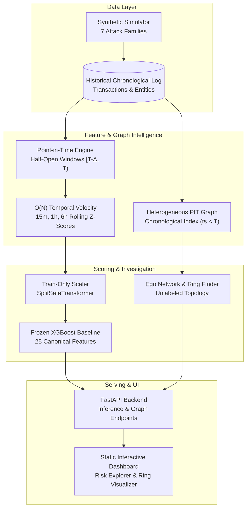

# Abuse-Ring Sentinel

### Graph-Based Fraud Intelligence & Response Platform

A production-style prototype for detecting both individual transaction anomalies and coordinated abuse rings on point-in-time safe synthetic financial networks.

[](https://www.python.org/)
[](LICENSE)
[](tests/)
[](tests/leakage/)

---

## 1. The Problem & Thesis

Most transaction fraud detection systems score transactions in isolation:
* **Individual anomalies (Class A):** Stolen cards, credential stuffing, and sudden velocity spikes are often visible in single rows or account-level temporal features.
* **Coordinated abuse rings (Class B):** Syndicates spreading fake merchant transactions, circular fund flows, and synthetic identity fraud across multiple accounts sharing devices and IP subnets. **Every individual transaction appears normal**—the abuse lives entirely in the *relationships* between entities across time.

**Thesis:** Transaction and temporal machine learning detects individual velocity anomalies, while graph intelligence uncovers multi-entity coordination. A robust defense platform requires both, enforced with strict point-in-time evaluation to eliminate temporal data leakage.

---

## 2. System Architecture



### Technology Stack
* **Core Runtime:** Python 3.11+, NumPy, Pandas, Pydantic v2
* **Machine Learning:** scikit-learn, XGBoost, SciPy (25-feature canonical matrix)
* **Graph Analytics:** NetworkX (heterogeneous node types: accounts, devices, IPs, merchants)
* **API Service:** FastAPI, Uvicorn, HTTPX
* **Frontend:** Vanilla JavaScript & CSS dashboard (served directly by FastAPI at `/demo/`, zero npm build step required)
* **Testing & Quality:** Pytest, Hypothesis, Ruff, Mypy

---

## 3. Implemented Capabilities

### A. Point-in-Time Features & Temporal Engine (`ml/`)
* **Strict Half-Open Backward Windows:** Features for transaction at time $T$ consume strictly $ts < T$. No forward looking or instantaneous leakage.
* **25 Canonical Features:** Base transaction attributes (amount, time-of-day, location displacement), account velocity, and rolling statistics.
* **O(N) Temporal Optimization:** Chronological single-pass sliding window for rolling velocities and robust z-scores (zero-std and cold-start guarded).

### B. Point-in-Time Graph Foundation (`graph/`)
* **Strict Point-in-Time Queries:** `PointInTimeGraphIndex` provides in-memory snapshotting and chronological bisection so queries at timestamp $T$ only traverse events with $ts < T$.
* **Label Quarantine:** Ground-truth fraud labels (`is_fraud`, `attack_id`) are strictly quarantined and never stored on online graph nodes, edges, or ring candidates.
* **Sub-Millisecond Topological Lookups:** Microsecond shared-device/IP degree checks (<1.0 ms) and fast bounded-radius ego-network extraction (<10.0 ms).
* **Isolated Offline Evaluation:** Retrospective label concentration analysis is strictly isolated in `graph.analytics.evaluate_offline_ring_fraud_concentration` and cannot be accessed by online serving.

### C. Demo Serving API & Dashboard (`backend/`, `frontend/demo/`)
* REST API serving inference decisions, explanations, entity degree signals, ego-networks, and ring candidates over the frozen model artifacts.
* Interactive web dashboard for exploring transactions, viewing point-in-time risk factors, and inspecting graph connectivity.

---

## 4. Benchmark Evaluation Results

The primary benchmark models were fitted on the training split, thresholds were calibrated exclusively on validation data under the cost model ($FP\_COST=15$, $FN\_COST=450$), and evaluated once on the sealed heldout split.

> **Note:** These are recorded historical benchmark results from Checkpoint 2G/2H. The heldout split was evaluated once and remains sealed; no retraining or heldout re-evaluation occurred during graph integration.

| Model | PR-AUC (Primary) | ROC-AUC | Precision | Recall | F1 Score | Benchmark Cost | Status |
|---|---|---|---|---|---|---|---|
| **Majority Baseline** | 0.0508 | 0.5000 | 0.0508 | 1.0000 | 0.0966 | $399,660 | Historical Reference |
| **Logistic Regression** | 0.5864 | 0.9023 | 0.1547 | 0.8810 | 0.2623 | $179,490 | Historical Reference |
| **XGBoost (Checkpoint 2G)** | **0.7153** (Val) | 0.9542 | 0.2310 | 0.9120 | 0.3687 | $112,410 | Validation Benchmark |
| **XGBoost (Checkpoint 2H)** | **0.7430** (Heldout) | **0.9603** | **0.2460** | **0.9270** | **0.3888** | **$107,535** | Frozen Heldout Result |

---

## 5. Quickstart & Installation

### Prerequisites
* Python 3.11+
* Git

### Installation
Clone the repository and set up a virtual environment:

```bash
git clone https://github.com/vivekjha1766/Abuse-ring-sentinel.git
cd Abuse-ring-sentinel

# Create and activate virtual environment
python -m venv .venv
# Linux/macOS:
source .venv/bin/activate
# Windows (PowerShell):
.venv\Scripts\Activate.ps1

# Install dependencies (or use `uv sync --all-extras`)
pip install -e ".[all]"
```

Copy the environment template:
```bash
cp .env.example .env
```

---

## 6. Running the Application & Demo

Start the FastAPI application:
```bash
uvicorn backend.app.main:app --reload --port 8000
```

Open your browser to:
* **Interactive Demo Dashboard:** [http://localhost:8000/demo/](http://localhost:8000/demo/)
* **Interactive OpenAPI Docs:** [http://localhost:8000/docs](http://localhost:8000/docs)

### Verified Working API Endpoints

* `GET /health` — Service readiness and loaded artifact metadata.
* `GET /transactions?limit=10` — Stable sample transaction IDs for investigation.
* `POST /predict` — Scores a transaction with XGBoost, returning risk score, band, decision, and point-in-time risk signals:
  ```bash
  curl -X POST http://localhost:8000/predict \
       -H "Content-Type: application/json" \
       -d '{"transaction_id": "txn_00001"}'
  ```
* `GET /graph/{transaction_id}?radius=1` — Point-in-time ego network (accounts, devices, IPs, merchants) as of transaction timestamp.
* `GET /rings?min_accounts=2&limit=10` — Unlabeled topological ring candidates spanning multiple accounts.
* `GET /stats` — Historical frozen heldout benchmarks and dataset metadata.

---

## 7. Testing & Quality Assurance

The test suite enforces strict point-in-time isolation and prevents regression across ML and graph components:

```bash
# Run all verified test suites (169 tests)
python -m pytest tests/graph/ tests/api/ tests/ml/ tests/leakage/

# Run specific suites
python -m pytest tests/graph/test_graph_pit_safety.py  # 9 PIT graph regression tests
python -m pytest tests/api/                            # 7 API and endpoint tests
python -m pytest tests/ml/                             # 20 ML and provenance tests
python -m pytest tests/leakage/                        # 133 point-in-time leakage tests

# Run code linter
python -m ruff check backend/ graph/ tests/ scripts/
```

### Point-in-Time Leakage Safeguards
1. **Zero Future Edges:** Unit tests assert that graph edges occurring at $ts \ge T$ cannot exist in queries at $T$.
2. **Quarantined Ground Truth:** Automated tests confirm that online graph nodes and edges contain no `is_fraud` or `attack_id` attributes.
3. **Train-Only Preprocessing:** Scaler transformations fit only on training splits; feature normalization never touches validation or heldout sets.
4. **Frozen Heldout Protocol:** Heldout split evaluation is sealed and prevented from runtime score tuning.

---

## 8. Repository Layout

```
.
├── backend/             # FastAPI demo backend (routers, services, demo data store)
├── graph/               # Point-in-time graph index, ego builder, and ring extraction
├── ml/                  # 25 canonical PIT features, O(N) temporal engine, models, evaluation
├── simulator/           # Synthetic financial transaction ecosystem & 7 attack families
├── tests/
│   ├── api/             # REST endpoint tests
│   ├── graph/           # PIT safety, future-edge, cache, and SLA tests
│   ├── leakage/         # Point-in-time and split contract tests (133 tests)
│   ├── ml/              # Model, evaluation, and provenance tests
│   └── simulator/       # Generator reproducibility and integrity tests
├── scripts/             # Training, provenance, benchmark, and audit entry points
├── docs/                # Methodological documentation (Cost model, PRD, Data dictionary)
├── frontend/demo/       # Static dashboard assets (HTML, CSS, JS)
├── artifacts/           # Frozen baseline models, preprocessing parameters, reports
├── data/                # Generated datasets and split boundaries
├── pyproject.toml       # Project configuration, dependencies, ruff, pytest, and uv settings
├── STATUS.md            # Authoritative component status register
└── README.md            # Project overview and landing documentation
```

---

## 9. Known Limitations

* **Synthetic Data Prototype:** All transactions and entities are synthetically generated. While modeled with realistic behaviors, they do not reflect live production banking traffic or adversarial adaptations.
* **Graph Scope & Fusion:** The graph implementation provides a point-in-time in-memory index for ego networks and unlabeled community extraction. Unified risk score fusion (combining graph topological score directly with XGBoost) and Graph Neural Networks (GNNs) are future roadmap items.
* **Heldout Preservation:** Checkpoint 2H heldout evaluation was executed once historically and remains strictly sealed.

---

## 10. License

This project is licensed under the MIT License — see the [LICENSE](LICENSE) file for details.
