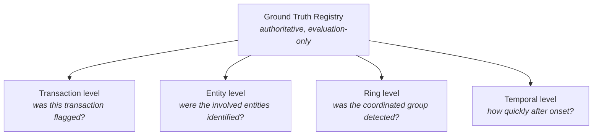
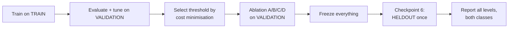

# Evaluation Protocol & Metric Definitions

**Status:** Checkpoint 1.5 — the metric set, the primary-metric choice, and the
threshold rule are executable (`ml/evaluation_contract.py`); no model exists, so
every result in §8 still reads `Not yet measured.`
Final held-out evaluation runs at Checkpoint 6.
**Owner:** Evaluation Agent (see `AGENTS.md`)

**Purpose.** Define every metric precisely, define the four levels at which
detection is measured, and specify the protocol that produces defensible results.
Ambiguous metric definitions are how misleading fraud results get published, so
each definition below states exactly what counts as a true positive.

---

## 1. Why four levels of evaluation

A single transaction-level number cannot describe this system's behaviour. If a
fake merchant ring involves 400 transactions across 20 entities and the system
flags 5 transactions belonging to 3 entities, then:

- transaction-level recall is poor (5/400),
- but the ring was **detected** — an investigator now has a thread to pull,
- and entity-level recall (3/20) describes how much of the ring is visible.

All three facts are true and they answer different questions. Reporting only the
first would understate the system; reporting only the second would overstate it.
So detection is measured at four levels, always reported separately.



---

## 2. Transaction-level metrics

The confusion matrix, defined over individual transactions:

| | Predicted fraud | Predicted legitimate |
|---|---|---|
| **Actually fraud** | True Positive (TP) | False Negative (FN) |
| **Actually legitimate** | False Positive (FP) | True Negative (TN) |

### Primary metrics

**Precision** = `TP / (TP + FP)` — of the transactions we flagged, what fraction
were actually fraud. Directly reflects analyst workload wasted on false alarms.

**Recall** (sensitivity, true positive rate) = `TP / (TP + FN)` — of the actual
fraud, what fraction did we catch. Directly reflects losses prevented.

**F1** = `2 × (Precision × Recall) / (Precision + Recall)` — harmonic mean.
Reported for comparability, but note it weights precision and recall equally,
which contradicts our 1:30 cost asymmetry. Total Error Cost is the operationally
meaningful summary.

**PR-AUC** (average precision) — area under the precision-recall curve.
**The primary ranking metric for this project.** Under heavy class imbalance,
PR-AUC responds to performance on the rare positive class, whereas ROC-AUC can
look strong while a model floods analysts with false positives.

### Secondary metrics

**ROC-AUC** — area under the ROC curve. Reported for completeness and
comparability with other work, explicitly *not* primary: with 5% prevalence the
large TN count makes ROC-AUC optimistic.

**Confusion matrix** — reported in full (all four cells), because the aggregate
metrics hide the raw counts that determine cost.

**False Positive Rate (FPR)** = `FP / (FP + TN)` — fraction of legitimate
transactions wrongly flagged.

**False Negative Rate (FNR)** = `FN / (TP + FN)` = `1 − Recall` — fraction of
fraud missed.

### Cost metric

**Total Error Cost** = `(FP × FP_COST) + (FN × FN_COST)`

Primary configuration `FP_COST = 15`, `FN_COST = 450`; sensitivity at 15/1000 and
50/450. These are synthetic benchmark assumptions, not real banking costs. See
`docs/COST_MODEL.md`.

### Accuracy — and why it is rejected

**Accuracy** = `(TP + TN) / (TP + TN + FP + FN)`.

At 5% prevalence, a model predicting "never fraud" achieves 95% accuracy with zero
recall. Accuracy rewards the degenerate solution and is therefore **not** used as a
primary metric anywhere in this project. It may appear in a results table for
completeness, always alongside the majority-classifier baseline that exposes its
uselessness.

---

## 3. Entity-level metrics

**Question:** did the system identify the entities involved in an attack?

An entity (customer, merchant, account, device, IP, or beneficiary) is a **detected
positive** if it appears in the system's set of implicated entities — via an alert
on one of its transactions, membership in a flagged graph community, or a
high-risk reputation/graph score above the operating threshold. The ground-truth
positive set is the attack's `affected_*_ids` from the registry.

- **Entity precision** = `|detected ∩ affected| / |detected|`
- **Entity recall** = `|detected ∩ affected| / |affected|`
- **Entity F1** = harmonic mean of the two

Reported per entity type as well as pooled, because detecting the shared *device*
in a ring is a different achievement from detecting all 20 *accounts*.

---

## 4. Ring-level metrics

**Question:** was the coordinated group detected as a group?

This needs an explicit definition, since "detected a ring" is otherwise
unfalsifiable. A ground-truth ring is counted as **detected** when the system
produces a candidate cluster (a graph community, shared-infrastructure finding, or
cycle) whose overlap with the ring's ground-truth entity set meets a declared
threshold.

**Overlap measure.** Jaccard index between the detected candidate set `D` and the
ground-truth ring set `R`:

```
J(D, R) = |D ∩ R| / |D ∪ R|
```

A ring counts as detected if `J(D, R) ≥ J_min` for some candidate `D`, where
`J_min` is a declared configuration constant reported with every result. Results
are reported across several `J_min` values rather than a single flattering one,
because a lenient threshold trivially inflates ring detection.

- **Ring precision** = detected candidate clusters matching a real ring ÷ all
  candidate clusters produced
- **Ring recall** = ground-truth rings detected ÷ all ground-truth rings
- **Ring F1** = harmonic mean
- **Cluster overlap** = mean `J(D, R)` over matched pairs — how *completely* rings
  were recovered, not just whether they were touched

Also reported: **shared-infrastructure detection** (did the system identify the
specific shared devices/IPs/beneficiaries linking the ring?) and **cycle
detection** (were circular money paths found, and at what cycle lengths?).

---

## 5. Temporal metrics

**Question:** how quickly after an attack begins is it detected?

**Detection latency** = `t_first_alert − t_attack_start`, where `t_attack_start` is
the ground-truth attack start time and `t_first_alert` is the timestamp of the
first alert attributable to that attack.

Reported as a distribution (median and spread across attacks) per attack family,
not as a single average — an attack family detected instantly and one never
detected should not average into "moderate".

Undetected attacks are **not** silently dropped from the latency statistics. They
are reported separately as a detection-failure count, since excluding them would
make latency look better precisely when the system performs worst.

---

## 6. Class A vs Class B reporting

**Every level's results are reported separately for Class A (individual/transaction
anomalies) and Class B (coordinated abuse)** as defined in `PRD.md` §4.

This is not optional presentation polish. The project's central hypothesis is that
transaction-level models handle Class A but struggle with Class B, and that graph
intelligence closes that gap. An aggregate metric averaged over both classes would
mathematically obscure the one effect the project exists to measure.

---

## 7. Evaluation protocol



Iteration happens on validation. The held-out set is opened exactly once, at
Checkpoint 6, with all models, hyperparameters, and thresholds already frozen. See
`docs/DATA_SPLIT_PROTOCOL.md`.

Every reported number carries its split, seed, threshold, cost configuration, and
the synthetic-data caveat, per `docs/EXPERIMENT_PROTOCOL.md` §8.

**What is executable as of Checkpoint 1.5.** `ml/evaluation_contract.py` holds the
metric definitions above as code — the confusion matrix, precision, recall, F1,
PR-AUC as the declared primary ranking metric, ROC-AUC as secondary, and Total
Error Cost — and it refuses to nominate accuracy as primary. It also owns the
threshold rule: selection sweeps the validation split and minimises Total Error
Cost, and a selection request naming any other split is refused by
`ml/split_policy.py` before scoring begins. The contract deliberately does *not*
train, score, or evaluate anything; it defines what a valid evaluation is so that
Checkpoint 2 cannot quietly redefine it. Fourteen checks in
`tests/leakage/test_evaluation_contract.py` cover the cost arithmetic, the
primary-metric guard, and the threshold-split guard.

---

## 8. Results

### 8.1 Transaction level

| Model / variant | PR-AUC | Precision | Recall | F1 | ROC-AUC | Total Error Cost |
|---|---|---|---|---|---|---|
| Not yet measured. | Not yet measured. | Not yet measured. | Not yet measured. | Not yet measured. | Not yet measured. | Not yet measured. |

### 8.2 Entity level

| Entity type | Precision | Recall | F1 |
|---|---|---|---|
| Not yet measured. | Not yet measured. | Not yet measured. | Not yet measured. |

### 8.3 Ring level

| Attack family | Ring precision | Ring recall | Ring F1 | Mean cluster overlap |
|---|---|---|---|---|
| Not yet measured. | Not yet measured. | Not yet measured. | Not yet measured. | Not yet measured. |

### 8.4 Temporal

| Attack family | Median detection latency | Spread | Undetected count |
|---|---|---|---|
| Not yet measured. | Not yet measured. | Not yet measured. | Not yet measured. |

---

## 9. Evaluation limitations

- **Synthetic ground truth.** Perfect labels are an artificial luxury; real fraud
  labels are delayed, incomplete, and partly wrong. Our metrics are optimistic
  relative to a real label environment.
- **Definitional sensitivity.** Ring-level results depend on `J_min` and on what
  counts as an "implicated entity". Both are declared and swept rather than
  silently chosen.
- **No cost of investigator time per ring.** Entity- and ring-level metrics do not
  price the effort of working a large cluster.
- **Single-generator bias.** All evaluation uses one generator's notion of fraud.
- **Not comparable externally.** These numbers cannot be compared to public fraud
  benchmarks or production systems.

---

## Related documents

- `docs/COST_MODEL.md` — cost definitions and threshold selection
- `docs/DATA_SPLIT_PROTOCOL.md` — split usage and the sealed held-out set
- `docs/EXPERIMENT_PROTOCOL.md` — reproducibility, ablation, reporting rules
- `docs/MODEL_BASELINES.md` — baseline ladder and results ledger
- `DATA_DICTIONARY.md` — ground-truth registry fields used for evaluation
- `MODEL_CARD.md` — intended use and limitations
- `PRD.md` — §4 detection classes A and B
