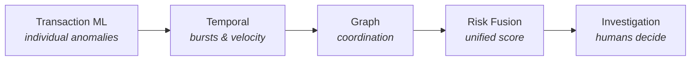
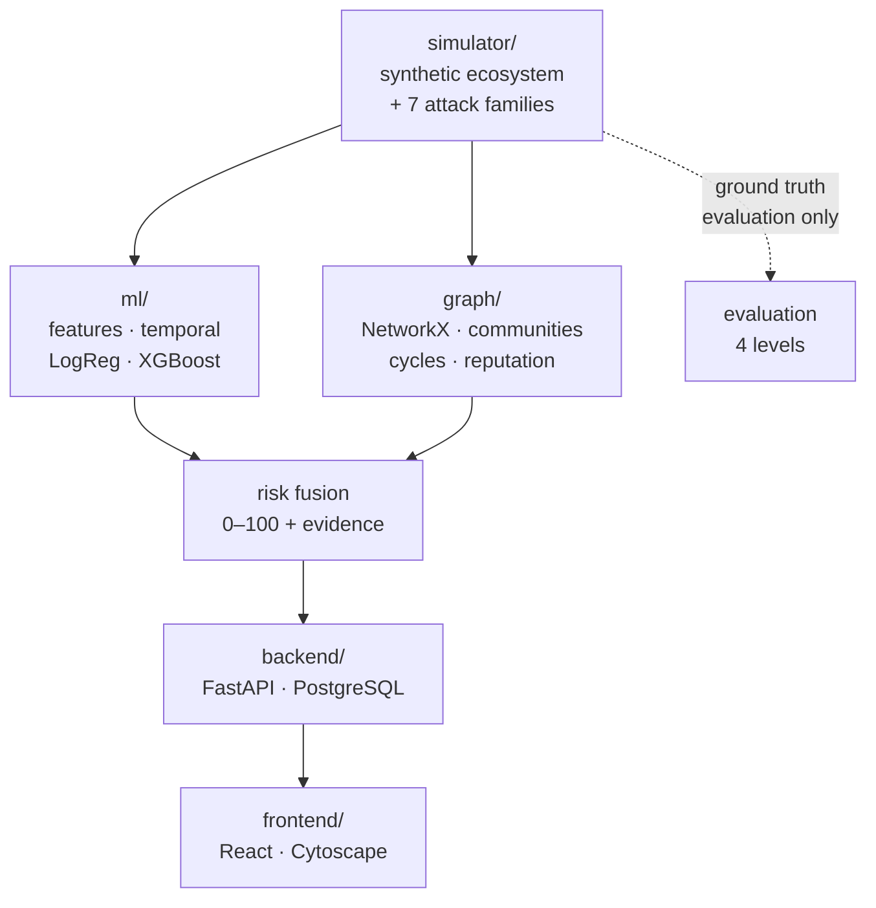

# Abuse-Ring Sentinel

**Current status:** See [STATUS.md](STATUS.md) for the authoritative implementation
state. Checkpoint 2H is complete, frozen, and sealed; the graph, backend, and
frontend additions remain demo-only surfaces around that frozen core.

**Graph-Based Fraud Intelligence & Coordinated Abuse Detection Platform**

A production-style portfolio prototype that detects both individual transaction
anomalies **and** coordinated fraud rings, on fully synthetic data.

> **Status: Checkpoint 2H of 8 complete — PIT-safe features, frozen baseline
> models, and a one-time sealed-heldout evaluation.**
> The simulator's dataset and shortcut audit (Checkpoint 1), the base and
> temporal feature extractors (Checkpoints 2A/2B, leakage-tested), and their
> integration (Checkpoint 2C) are complete. Checkpoint 2C's runtime benchmark
> found the original temporal implementation quadratic in transactions per
> account; `ml/temporal.py` now also exposes an O(n) chronological
> reimplementation (`compute_temporal_features`) that is checked against the
> original as a correctness oracle, with the audit-friendly original kept
> unchanged. Split-safe preprocessing (2D) and three frozen baseline models —
> Majority, Logistic Regression, and XGBoost (2E/2G) — are in place. The
> sealed heldout split has now been opened exactly once (Checkpoint 2H), after
> every threshold was already frozen on validation; see **Results** below for
> the frozen numbers. A demo API (`backend/`), an investigative point-in-time
> graph layer (`graph/`, strictly enforcing `ts < T` and zero label leakage in
> online serving), and a static dashboard (`frontend/demo/`) sit on top of this
> frozen core and change none of it. The sealed heldout dataset was not accessed
> or reopened during graph development. No production frontend, live graph risk
> scoring fusion, or entity-reputation layer exists yet.

---

## The problem

Most fraud-detection projects score one transaction at a time. That works for a
stolen card making unusual purchases — an individual anomaly, visible in a single
row of data.

It fails for organised abuse. When twenty accounts share three devices to funnel
money through four fake merchants, **every individual transaction can look
perfectly normal.** Reasonable amount, plausible merchant, ordinary hour, sensible
location. A per-transaction model sees twenty unremarkable customers, because the
feature vector for one transaction has no place to represent *"this device is also
used by nineteen other accounts that all pay the same four merchants."*

The fraud does not live in any transaction. It lives in the **relationships
between** them.

## The thesis

> Transaction-level ML detects individual anomalies. Graph intelligence detects
> coordinated abuse. A credible fraud platform needs both — and should be able to
> *measure* which one is doing the work.

This project is built to test that claim rather than assert it. Two detection
classes are defined and evaluated separately:

| | Class A — individual anomalies | Class B — coordinated abuse |
|---|---|---|
| **Example** | account takeover, sudden spike | fake merchant ring, shared-device ring, circular money flow |
| **Visible in one transaction?** | often yes | frequently no |
| **Expected detector** | transaction ML + temporal | graph intelligence |

An ablation study (transaction → +temporal → +graph → +reputation) measures each
layer's marginal contribution to each class. If the graph layer does not help on
Class B, the results will say so.

---

## Capability layers



Four signals — transaction, temporal, graph, and entity reputation — are computed
independently and combined into a single 0–100 score with attached, countable
evidence. Component scores are kept separate so the ablation is possible and so
every alert can explain itself.

---

## Engineering commitments

These are the parts worth reviewing, and they are enforced by tests rather than by
good intentions:

**Point-in-time feature safety.** Every feature for a transaction at time `T` reads
only data with `ts < T` — half-open backward windows `[T−Δ, T)`. This includes the
graph: the scoring graph is rebuilt **as-of `T`**, because a graph built from the
full dataset would let a ring's future edges inform its own detection. A dedicated
leakage test suite exists that may never be skipped, xfailed, or deleted.
See `docs/FEATURE_LEAKAGE_POLICY.md`.

**A sealed held-out set.** Splits are strictly temporal (60/20/20) and the held-out
set is opened exactly once, at Checkpoint 6, with all models, hyperparameters, and
thresholds already frozen. All iteration happens on validation.
See `docs/DATA_SPLIT_PROTOCOL.md`.

**Cost-sensitive evaluation, not accuracy.** At 5% prevalence, predicting "never
fraud" scores 95% accuracy with zero recall. PR-AUC is the primary ranking metric;
thresholds are chosen by minimising `FP×FP_COST + FN×FN_COST` on validation, never
assumed to be 0.5. See `docs/COST_MODEL.md` and `EVALUATION.md`.

**An ML-readiness gate before any modelling.** Checkpoint 1.5 audits whether the
synthetic data is even worth modelling: naive rules like "large amount ⇒ fraud"
must be demonstrably *weak*, legitimate outliers and legitimate device/IP sharing
must exist, and no giveaway artifact may separate the classes. If the audit fails,
the fix is the generator — never the metric. The gate passes at all four
prevalences, and each of its checks was verified capable of failing by seeding the
defect it claims to catch. See `docs/ML_READINESS.md`.

**No fabricated numbers.** Any quantity that has not been measured reads
"Not yet measured." Every number that does appear carries its split, seed,
threshold, cost configuration, and the synthetic-data caveat.
See `docs/EXPERIMENT_PROTOCOL.md`.

**Humans decide.** The system's most severe autonomous action is raising a CRITICAL
alert and *recommending* a hold. It never blocks, holds, or closes an account on
its own. The LLM Copilot (added last, deliberately) summarises existing evidence
and is constrained from determining fraud, recommending blocks, or inventing facts.

---

## Planned architecture



**Stack.** Python 3.11+, FastAPI, Pydantic v2, SQLAlchemy 2.0, Alembic, PostgreSQL
(SQLite for local dev), NumPy/Pandas/scikit-learn/XGBoost, NetworkX,
React + TypeScript + Vite + Tailwind + Recharts + Cytoscape.js, Docker Compose,
`uv` for Python packaging.

**Deliberately absent:** Neo4j (NetworkX is sufficient at this scale), graph neural
networks, and deep learning. Each is gated behind a written demonstration that
simpler methods are insufficient. Full rationale in `ARCHITECTURE.md`.

---

## Repository layout

```
simulator/       synthetic ecosystem + 7 parameterized attack families         (Checkpoint 1, frozen)
ml/              PIT-safe features, temporal, preprocessing, models, eval      (2A-2H, frozen)
graph/           PIT-safe investigation graph: entities, edges, ring candidates (PIT regression-tested)
backend/         FastAPI demo API serving the frozen XGBoost artifact          (this sprint)
frontend/demo/   static HTML/CSS/JS dashboard, no build step                   (this sprint)
frontend/src/    planned React + TypeScript dashboard                          (not started, empty)
tests/           unit · ml · graph · api · leakage · integration · e2e
docs/            cost model, split protocol, leakage policy, protocols, submission results
scripts/         dataset generation, baseline training, heldout evaluation
data/            generated datasets and splits (git-ignored)
artifacts/       models, preprocessing, reports (git-ignored)
```

Generated data and model artifacts are never committed — they are reproduced from a
seed and config. New training experiments also write a provenance manifest; the
frozen Checkpoint 2H artifacts and result payload are historical evidence and are
not rewritten.

---

## Documentation

Start here depending on what you want to know:

| Question | Document |
|---|---|
| What is being built and why? | `PRD.md` |
| How is it designed? | `ARCHITECTURE.md` |
| What happens next, and what's the plan? | `ROADMAP.md` |
| What does the data look like? | `DATA_DICTIONARY.md` |
| How is success measured? | `EVALUATION.md` |
| What are the models and their limits? | `MODEL_CARD.md` |
| Who owns which part of the build? | `AGENTS.md` |
| What rules does contributed code follow? | `CONTRIBUTING.md` |

Deeper specifications live in `docs/`: `COST_MODEL.md`, `ML_READINESS.md`,
`DATA_SPLIT_PROTOCOL.md`, `FEATURE_LEAKAGE_POLICY.md`, `FEATURE_REFERENCE.md`,
`EXPERIMENT_PROTOCOL.md`, `MODEL_BASELINES.md`.

---

## Getting started

```bash
cp .env.example .env      # non-secret defaults; set your own SECRET_KEY
uv sync --all-extras      # or: make install-all
uv run pytest             # simulator regression + leakage suites
make data                 # generate the dataset into data/ (seed 42, prevalence 5%)
python scripts/audit_ml_readiness.py --prevalence 0.05    # the Checkpoint 1.5 gate
```

`make help` lists the available targets. `make data` writes `data/raw/`
(transactions, entity tables, ground-truth registry, manifest, validation report)
and `data/splits/{warmup,train,validation,heldout}/`; the same seed and config
reproduce it byte-for-byte.

### Running the demo API and dashboard

```bash
export SENTINEL_EXPERIMENT_ID=<the checkpoint-2G experiment id you trained>
uv run uvicorn backend.app.main:app --reload --port 8000
```

Then open `http://localhost:8000/demo/` — the FastAPI app serves the static
dashboard directly, so there is nothing separate to build or start for the
frontend. If no local dataset exists yet (`make data` was not run), the API
falls back to a small illustrative synthetic fixture, clearly labelled in the
dashboard as a fallback rather than real data. The dashboard never reads
`data/splits/heldout`; its "frozen heldout evaluation" numbers are the
Checkpoint 2H results reported once, verbatim, in `backend/app/routers/stats.py`.

---

## Results

From the Checkpoint 2H sealed-heldout evaluation — run **exactly once**, after
every model, hyperparameter, and decision threshold was already frozen on the
validation split. These numbers are reported verbatim wherever they appear in
this repository; none are recomputed here.

| Model | PR-AUC (primary) | ROC-AUC | Precision | Recall | F1 | Benchmark cost |
|---|---|---|---|---|---|---|
| Majority baseline | 0.0508 | 0.5000 | 0.0508 | 1.0000 | 0.0966 | $399,660 |
| Logistic Regression | 0.5864 | 0.9023 | 0.1547 | 0.8810 | 0.2623 | $179,490 |
| **XGBoost (primary model)** | **0.7430** | **0.9603** | **0.2460** | **0.9270** | **0.3888** | **$107,535** |

Benchmark cost uses the synthetic `FP_COST=15` / `FN_COST=450` assumptions from
`docs/COST_MODEL.md`; it is not comparable across projects or to any real-world
cost. See `docs/SUBMISSION_RESULTS.md` for the full write-up, and
`docs/CHECKPOINT_1_VERIFICATION.md` / `docs/ML_READINESS.md` for the data-quality
findings this evaluation builds on.

---

## Limitations

Stated up front rather than buried, because a reviewer will find them anyway:

- **All data is synthetic.** There is no real PII, no real transaction, and no real
  customer anywhere in the pipeline. The system can only detect abuse the generator
  produces; the generator's assumptions become the system's apparent strengths and
  its blind spots.
- **Circular validity.** The same project defines both the attacks and the
  detectors. Varying attack parameters across splits mitigates this but does not
  eliminate it.
- **5% prevalence is a benchmark choice**, not a real-world or industry fraud rate.
  Cost values (`FP_COST=15`, `FN_COST=450`) are likewise benchmark assumptions;
  absolute cost totals have no external meaning, only relative comparisons under
  identical assumptions.
- **Results are not externally comparable** to public fraud benchmarks or
  production systems.
- **No adversarial adaptation.** Simulated attackers do not react to being detected.
- **Prototype scale.** This is a **production-style portfolio prototype**, not a
  system validated for real financial decisioning in a banking environment.
- **Graph layer scope.** The graph implementation provides a point-in-time safe
  chronological index (`ts < T`) for ego-networks and unlabeled ring candidate extraction.
  Graph risk score fusion into the primary ML model, GNN embeddings, and persistent
  graph databases remain future work / explicit limitations.
- **Sealed heldout preservation.** The Checkpoint 2H heldout evaluation was executed
  once historically and remains completely sealed; no heldout files were opened,
  scored, or altered during graph and API integration work.

---

## License

MIT — see `LICENSE`.
