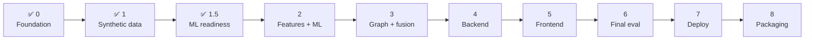

# Roadmap — Checkpoint Plan

**Status:** Checkpoints 0, 1, and 1.5 complete. Checkpoint 2 is unblocked but not
started.
**Owner:** Lead Architect (see `AGENTS.md`)

**Purpose.** Define the checkpoint sequence, what each delivers, and the exit
criteria that must be met before the next begins.

---

## The checkpoint discipline

This project is deliberately **not** built in one pass. Each checkpoint follows the
same cycle:

```
implement → test → verify → document → STOP → report
```

Work does not automatically continue to the next checkpoint. The developer reviews
the report and explicitly says "continue". The reason is practical: partial work
spread across three checkpoints is far worse than one finished, verified
checkpoint. A half-built graph engine sitting on top of an unverified feature
engine produces results nobody can trust.

Two invariants hold at every boundary:

1. **`uv run pytest` passes** before a checkpoint is called complete.
2. **No fabricated metrics.** Unmeasured quantities read "Not yet measured."

---

## Progress



| Checkpoint | Focus | Status |
|---|---|---|
| 0 | Foundation, architecture, documentation | ✅ Complete |
| 1 | Synthetic ecosystem, fraud simulator, ground truth | ✅ Complete (real `pytest` run carried forward) |
| 1.5 | ML-readiness audit, leakage controls | ✅ Complete — gate PASS at 1/5/10/25% |
| 2 | Feature engineering, temporal intelligence, LogReg + XGBoost | ⬜ Not started |
| 3 | Graph intelligence, entity reputation, risk fusion | ⬜ Not started |
| 4 | FastAPI, PostgreSQL, persistence | ⬜ Not started |
| 5 | React dashboard, graph explorer, simulation, investigation | ⬜ Not started |
| 6 | Held-out benchmark, cost analysis, ablation, monitoring, Copilot context | ⬜ Not started |
| 7 | Security, Docker, CI/CD, deployment | ⬜ Not started |
| 8 | Portfolio packaging, README, diagrams, demo, resume bullets | ⬜ Not started |

---

## Checkpoint 0 — Foundation ✅

**Delivers.** Project structure; product, architecture, and data documentation; ML
and evaluation specifications; development configuration.

**Artifacts.** `PRD.md`, `ARCHITECTURE.md`, `ROADMAP.md`, `DATA_DICTIONARY.md`,
`AGENTS.md`, `MODEL_CARD.md`, `EVALUATION.md`, `README.md`, `CONTRIBUTING.md`,
`LICENSE`, plus `docs/` (`COST_MODEL.md`, `ML_READINESS.md`,
`DATA_SPLIT_PROTOCOL.md`, `FEATURE_LEAKAGE_POLICY.md`, `FEATURE_REFERENCE.md`,
`EXPERIMENT_PROTOCOL.md`, `MODEL_BASELINES.md`) and configuration
(`pyproject.toml`, `.gitignore`, `.env.example`, `Makefile`).

**Exit criteria.** All documents exist and cross-reference correctly; no empirical
results claimed; directory structure in place; config parses; no ML, backend, or
frontend code written.

---

## Checkpoint 1 — Synthetic ecosystem & fraud simulator ✅

**Delivers.** The modular simulator, seven parameterized attack families, and the
ground-truth registry.

**Artifacts.** `simulator/config.py`, `entities.py`, `transactions.py`,
`base_generator.py`, `ground_truth.py`, `validation.py`, `pipeline.py`;
`simulator/attacks/` (fake merchant ring, shared device ring, transaction spike,
circular money flow, synthetic identity cluster, microtransaction attack, account
takeover); `scripts/generate_dataset.py`; `tests/simulator/`. Delivered beyond the
original list: `simulator/leakage.py` (label quarantine) and
`simulator/shortcut_audit.py` (adversarial single-feature audit).

**Exit criteria.** Six entity types generated with stable IDs and creation
timestamps; normal behaviour non-trivial (heterogeneous volumes, per-customer
profiles, legitimate outliers, limited legitimate device/IP sharing, seasonality);
all seven attacks parameterized with no hardcoded shapes; ground truth records all
required fields; same seed + config reproduces byte-identical output; configurable
prevalence at 1/5/10/25%; temporal 60/20/20 split with differing attack
configurations per split; `uv run pytest` green.

**Verification.** `docs/CHECKPOINT_1_VERIFICATION.md` records every measurement,
including the shortcut audit passing at all four prevalences with zero oracle
findings. One exit criterion is carried forward: the 106 regression tests pass
under a local pytest-compatible shim, but **real `uv run pytest` has not yet been
executed** because the development environment could not install pytest. The
simulator is otherwise implementation-frozen.

---

## Checkpoint 1.5 — ML-readiness audit ✅

**Delivers.** Execution of the audit specified in `docs/ML_READINESS.md`, plus the
leakage-control scaffolding features will be built against.

**Artifacts.** `ml/feature_contract.py` (field-role classification and
`assert_model_input_safe`), `ml/point_in_time.py` (`TransactionHistory` /
`HistoryView`, the single `ts < as_of` cut), `ml/split_policy.py` (executable
permissions matrix, train-only fitting, validation-only threshold selection,
sealed held-out loader), `ml/evaluation_contract.py` (metric and cost semantics,
no training); `scripts/audit_ml_readiness.py` (the gate CLI);
`tests/leakage/`.

**Exit criteria.** Dataset integrity checks pass; **triviality audit passes** —
"large amount ⇒ fraud" and "high count ⇒ fraud" are demonstrably weak classifiers,
legitimate outliers and legitimate sharing exist, no giveaway artifact; attacks
appear across all splits; ground-truth quarantine verified by an import-level test;
determinism confirmed; graph readiness confirmed (rings embedded, not trivially
separable components).

**Gate.** If the audit fails, fix the generator — never the metric. Checkpoint 2
does not begin until the audit passes.

**Verification.** The gate returns PASS at 1%, 5%, 10%, and 25%: 0 oracle
findings in 475–476 probes per prevalence, 0 quarantine breaches, 0 point-in-time
contaminations across 4,000 sampled rows recomputed against a truncated history,
and byte-identical manifests across two runs at seed 42. Every measurement is
recorded in `docs/ML_READINESS.md` with the command that reproduces it. Each
check was confirmed capable of failing: nine seeded data and window defects were
all caught by the check that claims to catch them, and twelve mutations to `ml/`
were all caught by `tests/leakage/`. No feature, model, or threshold was
produced, and the held-out split was not opened. The pytest carry-forward from
Checkpoint 1 still applies — the 63 leakage tests pass under the local
pytest-compatible shim and **real `uv run pytest` has not yet been executed**.
Nothing under `simulator/` was modified.

---

## Checkpoint 2 — Features, temporal intelligence, baseline ML

**Delivers.** The point-in-time feature engine, the feature registry, temporal
intelligence, preprocessing, the baseline model ladder, evaluation, and the cost
model.

**Artifacts.** `ml/features.py`, `ml/feature_registry.py`, `ml/temporal.py`,
`ml/preprocessing.py`, `ml/evaluation.py`, `ml/cost.py`; `tests/ml/`,
`tests/leakage/`.

**Exit criteria.** All specified features implemented with full provenance
metadata; **all leakage tests pass**; no feature emits `NaN`/`inf` under any
history length; temporal z-scores handle zero-std and insufficient history;
preprocessing fit on train only and artifacts saved; Model 0/1/2 trained;
`scale_pos_weight` computed from train only; threshold selected on validation by
cost minimisation (never assumed 0.5); results recorded per
`docs/EXPERIMENT_PROTOCOL.md`; `uv run pytest` green.

---

## Checkpoint 3 — Graph intelligence, reputation, risk fusion

**Delivers.** The heterogeneous graph, its detection signals, entity reputation,
the risk fusion engine, and explainability.

**Artifacts.** `graph/` (construction, metrics, community detection, cycles,
shared-infrastructure detection, reputation, fusion, explainability);
`tests/graph/`.

**Exit criteria.** Six node types and eight edge types built; degree, weighted
degree, communities (Louvain via NetworkX), centrality, cycles, and density
computed; `graph_risk_score` emitted with countable evidence; **scoring graph built
as-of `T`** and verified by a leakage test; reputation from prior confirmed
outcomes only; fusion produces a clamped 0–100 score with configurable weights and
component scores stored separately; risk levels and actions implemented with no
autonomous blocking; every evidence item maps to a real signal; `uv run pytest`
green.

---

## Checkpoint 4 — Backend & persistence

**Delivers.** The FastAPI application, PostgreSQL schema, and the
alert→case→feedback lifecycle.

**Artifacts.** `backend/app/` (`main.py`, `config.py`, `database.py`, `models/`,
`schemas/`, `routers/`, `services/`, `repositories/`); Alembic migrations;
`tests/api/`, `tests/integration/`.

**Exit criteria.** All router surfaces implemented; all specified tables migrated
with appropriate indexes; Pydantic v2 validation at every boundary; all data access
through the ORM; alert statuses and case lifecycle working; audit logging of state
transitions; API tests pass; `uv run pytest` green.

---

## Checkpoint 5 — Frontend

**Delivers.** The seven-screen React dashboard.

**Artifacts.** `frontend/` — Overview, Alert Center, Alert Detail, Graph Explorer
(Cytoscape), Investigation Center, Simulation Center, Model/Evaluation; typed API
client; frontend tests.

**Exit criteria.** All seven screens functional and traceable to a user job; graph
explorer supports node expansion, relationship inspection, cluster highlighting,
and path/cycle inspection; Simulation Center completes the configure → generate →
detect → visualize → compare-to-ground-truth round trip; evaluation screen shows
**only measured** metrics; alert detail renders real evidence with component score
breakdown; not a generic admin template.

---

## Checkpoint 6 — Final evaluation

**Delivers.** The one-time held-out benchmark, cost analysis, the ablation study,
lightweight monitoring, and the Copilot context layer.

**Exit criteria.** Held-out set opened **exactly once**, with all models,
hyperparameters, and thresholds frozen beforehand; all four evaluation levels
measured (transaction, entity, ring, temporal latency); Class A and Class B
reported **separately**; ablation A/B/C/D complete; cost sensitivity across
15/450, 15/1000, 50/450; FP/FN threshold analysis; multi-seed variability
reported; lightweight monitoring for model version, drift, prediction
distribution, latency, error rate; Copilot context provider plus mock interface
(no faked LLM output), with hard constraints enforced — no fraud determination, no
block recommendations, no invented facts.

---

## Checkpoint 7 — Security, Docker, CI/CD

**Delivers.** Security hardening and a reproducible deployment.

**Artifacts.** `Dockerfile`(s), `docker-compose.yml` (frontend, backend, postgres),
`.github/workflows/`, security review.

**Exit criteria.** Env-var configuration with no secrets in source; restricted CORS;
input validation; ORM-only queries; authorization on state-changing routes; audit
logs; rate limiting where practical; safe error messages; clean checkout builds and
runs via compose; CI runs lint + types + tests + the held-out-access guard.

---

## Checkpoint 8 — Portfolio packaging

**Delivers.** The portfolio-ready presentation.

**Artifacts.** Final `README.md` with screenshots and demo workflow; architecture,
data flow, ML pipeline, and graph pipeline diagrams; `docs/RESUME_BULLETS.md`.

**Exit criteria.** README covers overview, problem, solution, architecture,
features, screenshots, demo workflow, setup, dataset generation, experiments,
evaluation, limitations, and future work; all four diagram types present; resume
bullets in five formats (one-line, two-bullet technical, STAR, 60-second,
2-minute) containing **only** numbers that were actually measured; limitations
documented honestly; no claim of real-banking production readiness.

---

## Risks and how they are managed

| Risk | Mitigation |
|---|---|
| Synthetic data makes fraud trivially separable | Checkpoint 1.5 triviality audit gates all modelling |
| Circular validity — we design both attacks and detectors | Attack configurations differ across splits; limitation documented prominently |
| Silent data leakage inflates results | Structural prevention (as-of API, half-open windows) plus a leakage suite that cannot be skipped |
| Graph built from the full future leaks | Explicit as-of graph construction with a dedicated leakage test |
| Held-out contamination through repeated use | Sealed storage, guarded loader, CI guard, split recorded per run |
| Scope creep into unnecessary complexity | Complexity requires written justification; Neo4j/GNN/deep learning explicitly gated |
| Fabricated or drifting metrics in docs | "Not yet measured." discipline; every number carries split, seed, threshold, cost, caveat |
| Overclaiming in portfolio framing | Fixed language: "production-style portfolio prototype" on synthetic data |

---

## Assumptions

- Synthetic data is acceptable for the project's purpose; realism is bounded by the
  generator and this is disclosed rather than hidden.
- Prototype-scale volumes are sufficient to demonstrate the architecture; the
  system is not tuned for payment-network throughput.
- Cost values and the 5% prevalence are benchmark assumptions, not real-world
  figures, and conclusions drawn from them are conditional.
- NetworkX is sufficient at this scale; Neo4j and GNNs remain gated behind
  demonstrated need.
- Latency and throughput targets are set from a measured baseline at Checkpoint 6
  rather than invented now.

---

## Related documents

- `ARCHITECTURE.md` — target system design
- `PRD.md` — requirements and acceptance criteria
- `AGENTS.md` — who owns each checkpoint's work
- `docs/ML_READINESS.md` — the Checkpoint 1.5 gate
- `docs/EXPERIMENT_PROTOCOL.md` — how results are recorded
- `CONTRIBUTING.md` — the checkpoint workflow rules
