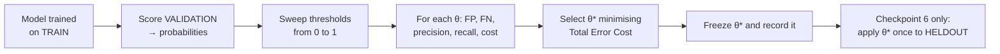

# Cost Model — Cost-Sensitive Evaluation

**Status:** Checkpoint 1.5 — the three configurations and the threshold rule are
executable (`ml/evaluation_contract.py`). No model exists, so every cost figure
below is still **Not yet measured.**
**Owner:** Evaluation Agent (see `AGENTS.md`)

**Purpose.** Fraud detection is an asymmetric decision problem: the two ways of
being wrong have very different consequences. This document defines how that
asymmetry is quantified, how it drives threshold selection, and — importantly —
the limits of what our cost numbers can support.

> **These cost values are synthetic benchmark assumptions.** They are not real
> banking costs, not industry figures, and not derived from any institution's
> data. Every conclusion drawn from them is conditional on them, which is why
> sensitivity analysis is mandatory rather than optional.

---

## 1. Why cost-sensitive evaluation, and why not accuracy

At the primary synthetic benchmark configuration of 5% fraud prevalence, a model
that predicts "never fraud" for every transaction achieves 95% accuracy while
catching exactly zero fraud. Accuracy rewards the degenerate solution. It is
therefore rejected as a primary metric throughout this project (see
`EVALUATION.md`), and the Model 0 majority classifier exists precisely to make
this failure mode visible in the results ledger.

Ranking metrics like PR-AUC fix the imbalance problem but answer a different
question: *how well does the model order transactions by risk?* They do not tell
an operator **where to cut**. A model can have identical PR-AUC at every
threshold; the choice of operating point is a business decision, and business
decisions need a cost function.

Total Error Cost supplies that:

```
Total Error Cost = (FP × FP_COST) + (FN × FN_COST)
```

where `FP` is the count of legitimate transactions flagged as fraud and `FN` is
the count of fraudulent transactions missed. Lower is better. The metric collapses
the confusion matrix into a single comparable scalar, which makes thresholds,
models, and ablation variants directly rankable.

---

## 2. Cost configurations

| Configuration | `FP_COST` | `FN_COST` | Ratio | Rationale |
|---|---|---|---|---|
| **Primary** | 15 | 450 | 1 : 30 | Baseline scenario. A false positive costs an analyst's review time and some customer friction; a missed fraud costs the disputed value plus handling. |
| Sensitivity A | 15 | 1000 | 1 : 67 | High-value fraud regime — misses dominate. Tests whether conclusions survive a much stronger recall incentive. |
| Sensitivity B | 50 | 450 | 1 : 9 | Expensive-review regime — scarce or costly investigators raise the price of every false positive. Tests whether conclusions survive a precision-leaning economy. |

Values are supplied through the `FP_COST` and `FN_COST` environment variables
(see `.env.example`) and are never hardcoded in detection logic.

### Reading the ratio

The 1:30 primary ratio has a direct operational meaning: **it is worth accepting
roughly thirty additional false positives to prevent one additional missed
fraud.** That pushes the optimal operating point toward high recall and a
threshold well below the naive 0.5. Sensitivity A pushes further in that
direction; Sensitivity B pulls back toward precision.

This is exactly why the threshold must be chosen by optimisation rather than
assumed. A default 0.5 cut encodes a 1:1 cost assumption that no configuration
here shares.

---

## 3. Threshold selection procedure

Threshold selection happens on the **validation split only**. The held-out test
set never participates — not in selection, not in "sanity checks". See
`docs/DATA_SPLIT_PROTOCOL.md`.



The chosen threshold `θ*` is recorded in the experiment record alongside the cost
configuration used to choose it. A threshold reported without its cost
configuration is meaningless, so both always travel together.

**Executable as of Checkpoint 1.5.** `ml.evaluation_contract.select_threshold()` is
the only sanctioned implementation of the procedure above. It calls
`assert_permitted(THRESHOLD_SELECTION, split)` first, so a request naming train,
warm-up, or held-out raises `SplitPolicyError` before any score is read; it sweeps
the distinct observed scores, minimises `total_error_cost`, and resolves ties to
the highest threshold (the fewest false positives). It returns a
`ThresholdDecision` that carries the split, the `CostConfig`, and the
`COST_ASSUMPTION` caveat string in its `to_dict()` — the three things a bare
threshold number leaves out. "Flag nothing" is excluded as a candidate: it is the
Model 0 baseline, reported separately rather than selected. The three
configurations in §2 are `PRIMARY_COST`, `SENSITIVITY_A`, and `SENSITIVITY_B`,
read from the environment by `cost_config_from_env()` so detection logic never
hardcodes a cost. No threshold has been selected, because no model exists.

---

## 4. Cost curve procedure

For each model and each cost configuration, we sweep the decision threshold and
record the full trade-off curve. This produces the data behind the
false-positive/false-negative analysis and the threshold visualisation in the
frontend evaluation screen.

Output table shape (one row per swept threshold, on the validation split):

| Threshold | FP | FN | Precision | Recall | F1 | Total Error Cost |
|---|---|---|---|---|---|---|
| Not yet measured. | Not yet measured. | Not yet measured. | Not yet measured. | Not yet measured. | Not yet measured. | Not yet measured. |

Summary of the selected operating point per model and cost configuration:

| Model | Cost config | θ* | FP @ θ* | FN @ θ* | Precision | Recall | Total Error Cost |
|---|---|---|---|---|---|---|---|
| Majority (Model 0) | 15 / 450 | Not yet measured. | Not yet measured. | Not yet measured. | Not yet measured. | Not yet measured. | Not yet measured. |
| Logistic Regression | 15 / 450 | Not yet measured. | Not yet measured. | Not yet measured. | Not yet measured. | Not yet measured. | Not yet measured. |
| XGBoost | 15 / 450 | Not yet measured. | Not yet measured. | Not yet measured. | Not yet measured. | Not yet measured. | Not yet measured. |
| XGBoost | 15 / 1000 | Not yet measured. | Not yet measured. | Not yet measured. | Not yet measured. | Not yet measured. | Not yet measured. |
| XGBoost | 50 / 450 | Not yet measured. | Not yet measured. | Not yet measured. | Not yet measured. | Not yet measured. | Not yet measured. |

A robustness question the sensitivity analysis is designed to answer: **does the
ranking of models change when costs change?** If model ordering is stable across
all three configurations, the conclusion is far stronger than a single-cost
result. If ordering flips, that must be reported prominently rather than
resolved by picking the flattering configuration.

---

## 5. Cost and the human-review boundary

Total Error Cost treats a flagged transaction as a binary outcome, but the
product does not act that way. Risk levels map to graded responses — LOW allow,
MEDIUM monitor, HIGH enhanced verification / human review, CRITICAL human review
/ temporary hold — and no consequential action is taken autonomously (see
`PRD.md` FR-10).

This means `FP_COST` is best read as *the cost of consuming review capacity and
imposing customer friction*, not as the cost of wrongly blocking someone. The
model is not permitted to wrongly block anyone; a human decides. The cost model
therefore prices analyst attention, which is the genuinely scarce resource.

---

## 6. Limitations

Stated plainly, because cost models invite overclaiming:

- **The values are assumptions.** 15 and 450 were chosen to create a meaningful
  asymmetry for a synthetic benchmark. They are not calibrated against any real
  institution.
- **Real costs are heterogeneous.** In reality FP and FN costs vary by customer
  segment, product, geography, transaction value, and repeat-offence status. A
  single scalar per error type is a simplification.
- **Cost is value-independent here.** A missed $10 fraud and a missed $10,000
  fraud both cost `FN_COST`. A value-weighted variant would be more realistic;
  it is noted as future work rather than silently assumed.
- **Review capacity is not modelled as a constraint.** In practice an analyst
  team has a finite daily queue, which caps the number of alerts that can be
  actioned regardless of what cost minimisation prefers.
- **Second-order effects are excluded.** Customer churn from friction,
  reputational damage, regulatory exposure, and fraudster adaptation to a known
  threshold are all real and all out of scope.
- **Synthetic data.** All costs are computed over synthetic transactions, so
  absolute cost totals have no external meaning. Only *relative* comparisons
  between models and variants, under identical assumptions, are informative.

---

## Related documents

- `EVALUATION.md` — full metric definitions and evaluation protocol
- `docs/DATA_SPLIT_PROTOCOL.md` — why threshold tuning is validation-only
- `docs/MODEL_BASELINES.md` — results ledger including cost columns
- `docs/EXPERIMENT_PROTOCOL.md` — what must accompany every reported number
- `PRD.md` — §8 benchmark configuration, FR-10 risk levels and actions
