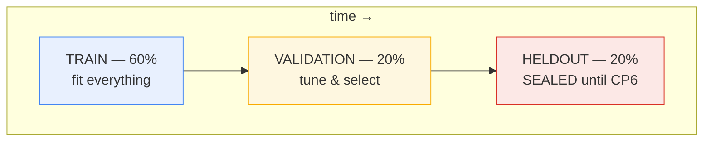

# Data Split Protocol — Temporal Splitting & the Sealed Held-Out Set

**Status:** Checkpoint 1.5 — the permissions matrix and the seal are executable
(`ml/split_policy.py`). Applied to models and preprocessing from Checkpoint 2.
**Owner:** Data + Evaluation Agents (see `AGENTS.md`)

**Purpose.** Define exactly how the dataset is partitioned for training,
validation, and final testing; what each partition may and may not be used for;
and the discipline that keeps the held-out set trustworthy. Splitting is where
fraud evaluations most often quietly cheat, so the rules here are explicit and
mechanically enforced.

---

## 1. Why not a random split

Random `train_test_split` is invalid for this problem for three independent
reasons:

1. **Temporal leakage.** Fraud detection is a forecasting problem — score a
   transaction using only the past. A random split scatters future transactions
   into the training set, letting the model learn from information it could never
   have at inference time. Reported metrics become optimistic fiction.
2. **Realism of deployment.** In production a model is trained on history and
   applied to what comes next. A chronological split mirrors that; a random split
   does not.
3. **Coordinated-attack structure.** Rings unfold over time. Randomly splitting a
   ring's transactions puts some in train and some in test, so the model can
   memorise the ring rather than generalise to new ones.

We therefore use a strict chronological split.

---

## 2. The split

Transactions are ordered by timestamp and cut into three contiguous blocks:

| Split | Share | Time position | Primary use |
|---|---|---|---|
| **TRAIN** | 60% | earliest | Fit models; fit preprocessing; compute class ratio |
| **VALIDATION** | 20% | middle | Select threshold, hyperparameters, model, early stopping |
| **HELDOUT TEST** | 20% | latest | Final reporting **once**, at Checkpoint 6 |

with the strict ordering `max(t) in TRAIN < min(t) in VALIDATION < min(t) in
HELDOUT`.

Split boundaries are computed from transaction timestamps by quantile so the
proportions hold regardless of density variation over time. The exact boundary
timestamps are recorded with the dataset version.

---

## 3. Permissions matrix

What each split is allowed to touch is the whole game.

| Operation | WARM-UP | TRAIN | VALIDATION | HELDOUT |
|---|:---:|:---:|:---:|:---:|
| Fit model parameters | ❌ | ✅ | ❌ | ❌ |
| Fit preprocessing (scalers, encoders, imputers) | ❌ | ✅ | ❌ | ❌ |
| Compute class ratio / `scale_pos_weight` | ❌ | ✅ | ❌ | ❌ |
| Hyperparameter search | ❌ | ❌ | ✅ | ❌ |
| Early stopping | ❌ | ❌ | ✅ | ❌ |
| Threshold selection (cost minimisation) | ❌ | ❌ | ✅ | ❌ |
| Model selection between candidates | ❌ | ❌ | ✅ | ❌ |
| Final metric reporting | ❌ | ❌ | ❌ | ✅ (once, CP6) |
| Apply already-fitted preprocessing (transform) | ✅ | ✅ | ✅ | ✅ |
| Provide prior rows as feature history | ✅ | ✅ | ✅ | ✅ |
| Any other use before Checkpoint 6 | — | — | — | ❌ |

The held-out column is almost entirely ❌ by design. It is opened exactly once,
in Checkpoint 6, to produce the final numbers — and nothing that happens there
feeds back into any model or threshold.

The last two rows are permitted everywhere, and that is not a loophole. Applying a
train-fitted transform to held-out rows consumes nothing from held-out: the
parameters were already fixed. Likewise, a held-out transaction's own earlier rows
are its past and reading them is the point of point-in-time features. What is
forbidden is *deriving* anything from held-out rows, which is why fitting and
transforming are separate operations rather than one convenience method.

This table is executable. `ml/split_policy.py` holds it as `PERMISSIONS` and
`assert_permitted()` raises `SplitPolicyError` on anything absent from it —
including a fit whose data spans two splits, a second fit on an
already-fitted transformer, and an unrecognised split name. The matrix is
transcribed a second time, by hand, into
`tests/leakage/test_split_policy.py::EXPECTED_PERMISSIONS`, so relaxing a rule
requires editing a test that spells out the old one. That redundancy is
deliberate.

---

## 4. Sealing the held-out set

Discipline that depends on remembering is discipline that fails. The seal is
enforced by mechanism:

- **Separate storage.** The held-out split lives at its own path
  (`data/splits/heldout/`) distinct from train and validation.
- **A guarded loader.** `ml.split_policy.unseal_heldout()` requires an explicit
  `unseal=True` *and* a non-empty written reason, and it emits a warning naming the
  calling file and line. Without both, it raises `SealedSplitError` **without
  calling the loader at all** — so an accidental read does not merely fail after
  the fact, it never happens.
- **Training scripts cannot reach it.** `scripts/generate_dataset.py` and the
  training entry points never import the held-out loader. A test asserts this.
- **CI guard.** A continuous-integration check greps the training and feature
  code paths for held-out access and fails the build if found.
- **Experiment records name the split.** Every recorded run states which split
  produced its numbers (see `docs/EXPERIMENT_PROTOCOL.md`), so a held-out number
  appearing before Checkpoint 6 is immediately visible.

If the held-out set is ever touched prematurely — even by accident — the honest
remedy is to regenerate a fresh held-out split from a new time period, not to
pretend it did not happen.

---

## 5. Boundary and continuity handling

**Transactions at a boundary.** A transaction whose timestamp equals a boundary is
assigned to the later split, consistent with the strict-inequality ordering. This
is deterministic and recorded.

**Entity spillover across splits.** An account, device, or merchant may legitimately
appear in more than one split — a real customer active for months spans all three.
This is allowed and realistic. It is *not* leakage, **provided features remain
point-in-time correct**: when scoring a validation transaction, the account's
history from the train period is exactly the past and may be used. What is
forbidden is using the account's *future* (validation/test) activity when scoring
an *earlier* transaction. Point-in-time safety (see
`docs/FEATURE_LEAKAGE_POLICY.md`) handles this automatically because features only
ever read `ts < t_T`.

**Warm-up history.** The longest feature window is 7 days (`tx_velocity_7d`,
`tx_volume_7d`). Transactions in the first 7 days of the TRAIN split have
truncated history and are handled by the cold-start policy — computed over
available history, flagged `cold_start`, never `NaN`/`inf`. The generator produces
a warm-up period of normal activity before the evaluation window begins so that
the bulk of transactions have full history.

---

## 6. Attack-configuration generalization across splits

To test whether detectors generalise to attack *configurations* they have not
seen, the splits deliberately do not share identical attack parameters. Attack
families are the same; their parameters differ and generally intensify toward the
held-out period.

| Attack aspect | TRAIN | VALIDATION | HELDOUT |
|---|---|---|---|
| Ring size | small | medium | larger |
| Circular-flow cycle length | 3-node cycles | 4–5 node cycles | 6-node cycles |
| Transaction spike multiplier | ~5× | ~7× | ~10× |
| Parameter distribution | narrower | shifted | broader / different combinations |

This design answers a specific question: *does a detector tuned on small rings and
mild spikes still find large rings and severe spikes it never saw during
training?* A model that only recognises memorised configurations will show the gap
here.

> **Explicit caveat.** This tests generalization to unseen attack
> *configurations*. It does **not** make the benchmark equivalent to a real
> production deployment. Real attackers invent new *types* of attacks and adapt
> against the detector; this protocol varies parameters within a fixed set of
> known families. See `PRD.md` §11 (limitations).

---

## 7. What invalidates the protocol

Any of the following voids the evaluation and must be disclosed, not patched over:

- Selecting a threshold, hyperparameter, or model using held-out data.
- "Peeking" at held-out metrics before Checkpoint 6 and letting them influence any
  choice.
- Refitting preprocessing on validation or test.
- Computing class ratio or `scale_pos_weight` on anything but train.
- Reusing the held-out set across multiple modelling iterations until something
  scores well (multiple-comparisons leakage).
- Reporting a metric without stating the split, seed, threshold, and cost config
  it came from.

---

## 8. Status of measurements

Measured 2026-08-25 from the generated dataset at seed 42, prevalence 0.05 (the
primary synthetic benchmark configuration — a benchmark choice, not a real-world
fraud rate). Boundaries are the 60th and 80th percentiles of in-window normal
transaction timestamps, recorded in `data/raw/manifest.json` alongside the config
fingerprint `80c206b06d07d42b`.

| Boundary | Timestamp |
|---|---|
| `evaluation_start` | 2026-01-01T00:00:00+00:00 |
| `train_end` | 2026-03-17T18:16:58.655506+00:00 |
| `validation_end` | 2026-04-09T16:45:44.105213+00:00 |
| `evaluation_end` | 2026-05-01T00:00:00+00:00 |

| Split | Transactions | Fraud | Normal | Realised prevalence | Realised share |
|---|---|---|---|---|---|
| warm-up | 13,864 | 0 | 13,864 | 0.0 | — (not scored) |
| train | 85,985 | 4,194 | 81,791 | 0.04878 | 0.6035 |
| validation | 28,434 | 1,435 | 26,999 | 0.05047 | 0.1996 |
| heldout | 28,069 | 1,425 | 26,644 | 0.05077 | 0.1970 |

Realised shares deviate slightly from the configured 0.60/0.20/0.20 because
boundaries are fixed on normal traffic before attacks are injected. Boundary
timestamps for the other supported prevalences differ, since each config produces
its own traffic; they are recorded in that dataset's own manifest.

These are dataset properties only. No model has been trained and no split has been
scored: detection metrics remain **Not yet measured.**

The held-out row and label counts above come from the readiness audit's
class-presence and prevalence checks, which are dataset-integrity reads over the
in-memory generated dataset — not from the sealed loader, and not from anything
fitted, scored, or tuned. That distinction is the whole content of the seal:
verifying that held-out contains both classes is a property of the *data*, while
deriving a scaler, a hyperparameter, a model, or a threshold from it would consume
the split. The former has happened; the latter has not.

**Enforcement measured at Checkpoint 1.5.** `tests/leakage/test_split_policy.py`
runs 16 checks against `ml/split_policy.py`, all passing: the matrix above matches
`PERMISSIONS` exactly; a scaler refuses to fit on validation, held-out, or warm-up
and its `_fit` is never entered; it refuses a fit spanning `["train",
"validation"]`; it refuses a second fit and keeps the first parameters; it refuses
to transform before fitting; threshold selection is refused on every split but
validation; the held-out loader is refused by default without being called; and
unsealing without a reason is refused while unsealing with one warns, naming the
caller. Four mutations to the policy — permitting a validation fit, permitting
held-out threshold selection, disabling the seal, disabling the refit guard — were
each caught. The audit itself never calls the sealed loader, never fits anything,
and never selects a threshold.

See `docs/CHECKPOINT_1_VERIFICATION.md` §7 for the integrity checks behind these
numbers.

---

## Related documents

- `docs/FEATURE_LEAKAGE_POLICY.md` — point-in-time rules that make entity
  spillover safe
- `docs/COST_MODEL.md` — threshold selection on validation only
- `docs/ML_READINESS.md` — audit that attacks appear in all splits
- `docs/EXPERIMENT_PROTOCOL.md` — recording the split behind every number
- `EVALUATION.md` — metric definitions
- `PRD.md` — §8 benchmark configuration, §11 limitations
