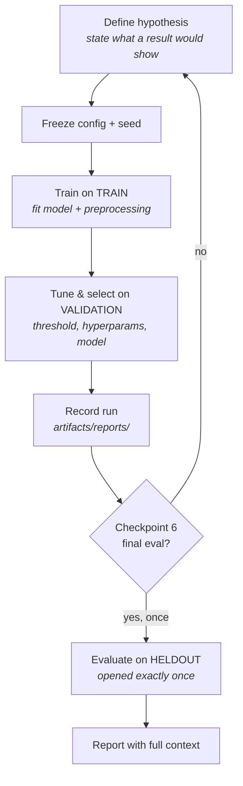

# Experiment Protocol

**Status:** Checkpoint 0 — specification. Applied to every experiment from
Checkpoint 2 onward.
**Owner:** ML + Evaluation Agents (see `AGENTS.md`)

**Purpose.** Define how experiments are run, recorded, and made reproducible so
that every number in this project can be traced to a seed, a config, and a split.
An unrecorded result does not exist; an unreproducible result is an anecdote.

---

## 1. Reproducibility contract

Every experiment must satisfy all of the following:

- **One master seed fans out.** A single `SENTINEL_SEED` derives per-component
  seeds (generator, split, model init, sampling). The whole pipeline is a
  deterministic function of that seed plus the config.
- **Config is captured.** The exact configuration (prevalence, cost values,
  window widths, model hyperparameters, split boundaries) is recorded with the
  run, and hashed so identical configs are detectable.
- **Environment is recorded.** Python version and key dependency versions
  (NumPy, pandas, scikit-learn, XGBoost, NetworkX) are stored with the run.
- **Determinism is enforced.** Library-level nondeterminism is pinned where it
  exists (e.g. fixed random states, single-threaded where thread scheduling
  affects results, sorted iteration over sets/dicts feeding models).
- **Same seed + same config ⇒ identical results.** This is testable and is
  treated as a regression check, not an aspiration.

---

## 2. Experiment record schema

Each run writes a record under `artifacts/reports/`. Required fields:

| Field | Meaning |
|---|---|
| `experiment_id` | Unique identifier for the run |
| `timestamp` | When it ran |
| `git_commit` | Exact code revision |
| `seed` | Master seed used |
| `config_hash` | Hash of the full resolved config |
| `dataset_version` | Which generated dataset (and its prevalence setting) |
| `split` | `train` / `validation` / `heldout` — which split the numbers came from |
| `feature_set` | Ablation variant (A/B/C/D) or explicit feature list |
| `model_type` | `majority` / `logreg` / `xgboost` / rule |
| `hyperparameters` | Full hyperparameter set |
| `preprocessing_ref` | Reference to the fitted preprocessing artifact |
| `threshold` | Operating threshold and how it was chosen |
| `cost_config` | `FP_COST` / `FN_COST` used |
| `metrics` | All computed metrics (see `EVALUATION.md`) |
| `notes` | Observations, caveats, anomalies |

The record makes a claim auditable: given the record, another person can rebuild
the exact conditions and confirm the numbers.

---

## 3. Experiment lifecycle

The loop between hypothesis, train, validate, and record runs many times. The
held-out branch is taken exactly once, in Checkpoint 6. Nothing measured on the
held-out set flows back into a model, threshold, or selection decision.

---

## 4. Rules of engagement

- **One variable at a time.** Change one thing per experiment so an effect is
  attributable. Bundling changes forfeits the ability to explain a result.
- **The held-out set is opened once.** No exceptions, no "quick checks". See
  `docs/DATA_SPLIT_PROTOCOL.md`.
- **No number without a record.** A metric cited anywhere — doc, README, commit,
  UI — must correspond to a recorded run.
- **Negative results are kept.** An experiment that fails to improve, or that
  makes things worse, is recorded and retained. It is often the most informative
  outcome, especially for the transaction-vs-graph story.
- **Never delete an unflattering experiment** to make the ledger look better.

---

## 5. The ablation study

The project's headline research artifact. Four cumulative variants, each adding
one detection layer:

| Variant | Feature composition | Question it answers |
|---|---|---|
| **A** | Transaction only | How far do per-transaction features alone go? |
| **B** | Transaction + Temporal | Does burst/temporal intelligence add signal? |
| **C** | Transaction + Temporal + Graph | Does relational structure catch coordinated abuse the others miss? |
| **D** | Transaction + Temporal + Graph + Reputation | Does historical entity risk add further lift? |

Results (validation; held-out filled only at Checkpoint 6):

| Variant | PR-AUC | Precision | Recall | F1 | Total Error Cost |
|---|---|---|---|---|---|
| A — Transaction | Not yet measured. | Not yet measured. | Not yet measured. | Not yet measured. | Not yet measured. |
| B — + Temporal | Not yet measured. | Not yet measured. | Not yet measured. | Not yet measured. | Not yet measured. |
| C — + Graph | Not yet measured. | Not yet measured. | Not yet measured. | Not yet measured. | Not yet measured. |
| D — + Reputation | Not yet measured. | Not yet measured. | Not yet measured. | Not yet measured. | Not yet measured. |

**Report Class A and Class B separately.** Individual-anomaly performance and
coordinated-ring performance must be reported in separate columns/tables, because
an aggregate metric averaged across both classes hides the exact effect the
ablation exists to measure. The central hypothesis is that variant C improves
Class B (rings) more than the transaction-only variant A; that can only be seen if
Class B is not averaged away.

---

## 6. Hyperparameter search policy

- The search space is declared **in advance** and recorded with the run.
- Selection is on **validation only**. Never on held-out.
- The search **budget** (number of trials / grid size) is stated.
- **Early stopping**, where used, monitors validation, never test.
- The chosen configuration and the search that produced it are both recorded, so
  the selection is reproducible rather than a lucky draw.

---

## 7. Statistical honesty

- **A single-seed result is an anecdote.** Headline comparisons are repeated
  across multiple seeds, and the run-to-run variability is reported alongside the
  central value.
- **Do not claim an improvement smaller than variability.** If variant C beats
  variant A by less than the spread across seeds, the honest statement is "no
  measurable difference", not "C is better".
- **Report dispersion, not just the mean.** Where multiple seeds are run, report
  the range or standard deviation.

---

## 8. What must accompany every reported number

No metric is ever reported bare. Each is stated with:

1. the **split** it came from (train / validation / held-out),
2. the **seed** (or seed set),
3. the **threshold** and how it was selected,
4. the **cost configuration** (`FP_COST` / `FN_COST`), and
5. the **synthetic-data caveat** — results are on synthetic data and are not
   comparable to public benchmarks or production systems.

A number without these five is not reportable.

---

## Related documents

- `EVALUATION.md` — metric definitions and evaluation levels
- `docs/DATA_SPLIT_PROTOCOL.md` — split usage and the sealed held-out set
- `docs/COST_MODEL.md` — cost configurations and threshold selection
- `docs/MODEL_BASELINES.md` — the baseline ladder and results ledger
- `docs/FEATURE_REFERENCE.md` — feature groups that define the ablation variants
- `MODEL_CARD.md` — model intent, data, and limitations
