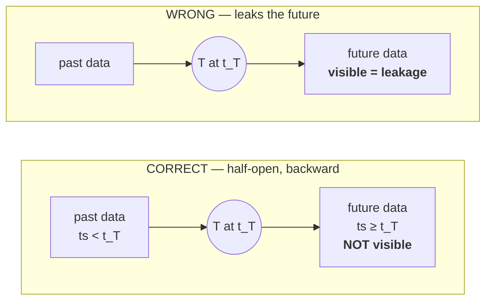
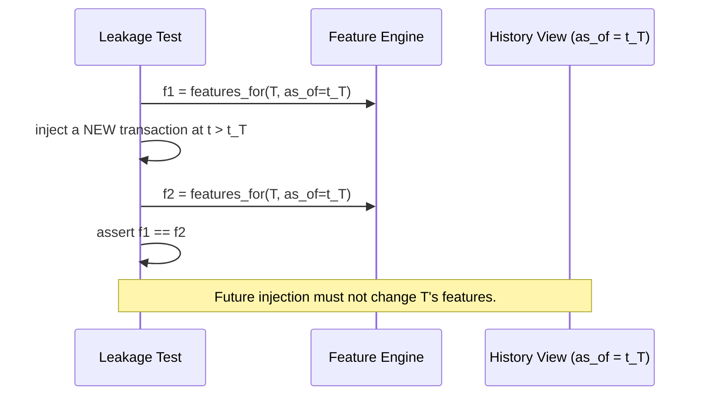

# Feature Leakage Policy — Point-in-Time Safety

**Status:** Checkpoint 1.5 — the rule, the history API, and the leakage suite are
implemented and passing. Per-feature enforcement continues from Checkpoint 2.
**Owner:** ML Agent (see `AGENTS.md`)

**Purpose.** This document defines the single most important correctness rule in
the project and the mechanisms that enforce it. Data leakage — letting
information that would not have been available at prediction time influence a
prediction — is the failure that most often makes a fraud model look excellent in
evaluation and worthless in reality. In a project where we also *generate* the
data, leakage is especially easy to introduce by accident, so we treat it as a
first-class engineering hazard with tests, not as a code-review afterthought.

---

## 1. The non-negotiable rule

> **For a transaction `T` occurring at time `t_T`, a feature may depend only on
> data whose timestamp is strictly less than `t_T`.**
>
> All historical windows are **half-open and backward-looking**: `[t_T − Δ, t_T)`.
> Never `[t_T − Δ, t_T + Δ)`. Never anything with an upper bound `≥ t_T`.

This applies to every feature, every rolling statistic, every entity reputation,
and every graph signal used to score `T`. There are no exceptions for
"convenience", "it barely matters", or "the effect is small". A feature that
violates this rule is wrong and must be fixed or removed.

Why *strictly* less than, not less-than-or-equal? Because a transaction cannot use
itself, and two transactions can share a timestamp. Including `ts == t_T` would
let a simultaneous event (possibly part of the same coordinated burst) inform the
score. The boundary is exclusive and is tested explicitly.

---

## 2. Three enforcement mechanisms

Leakage prevention does not rely on remembering to be careful. It is enforced
structurally.

**Mechanism 1 — explicit `as_of` time.** Every feature function receives an
explicit `as_of` timestamp and a *history view* object. The function has no way to
reach the full dataset; it can only query the history view, which filters
`ts < as_of`. The absence of a global data handle in feature code is deliberate.

**Mechanism 2 — half-open backward windows everywhere.** Window helpers accept a
width `Δ` and an `as_of` time and return the slice `[as_of − Δ, as_of)`. There is
one window implementation; features do not roll their own. Centralising the window
logic means the boundary is correct in exactly one place.

**Mechanism 3 — automated leakage tests.** A dedicated test suite (`-m leakage`)
injects future data and asserts that already-computed features are unchanged.
These tests are load-bearing: they must never be skipped, `xfail`-ed, or deleted
to make a build green. If a leakage test fails, the feature is wrong, not the
test.

---

## 3. Required leakage test cases

The suite below is the minimum. Every new feature adds at least one case.

| Test name | What it does | Assertion |
|---|---|---|
| `test_future_transaction_injection` | Computes features for `T`, injects a transaction at `t > t_T`, recomputes | Features for `T` are byte-identical before and after |
| `test_future_amount_no_effect` | Injects a large-amount future transaction for the same account | `amount_deviation`, volume features for `T` unchanged |
| `test_future_merchant_stats_no_effect` | Adds future transactions to the merchant | Merchant-derived features for `T` unchanged |
| `test_future_customer_stats_no_effect` | Adds future activity for the customer | Customer/account-derived features for `T` unchanged |
| `test_boundary_exclusive` | Adds a transaction at exactly `t_T` | It is **excluded** from `T`'s windows (strict `<`) |
| `test_recompute_determinism` | Recomputes the same features twice | Identical output for identical input |
| `test_window_is_half_open` | Probes `[t_T − Δ, t_T)` edges with events at `t_T − Δ` and `t_T` | Lower edge included, upper edge excluded |
| `test_ground_truth_unreachable` | Static/import check on feature modules | No feature module imports the ground-truth registry |
| `test_reputation_history_only` | Builds reputation with a future confirmed-fraud outcome | Reputation at `t_T` ignores the future outcome |
| `test_graph_asof_construction` | Builds the scoring graph with future edges present | Graph signals for `T` use only edges with `ts < t_T` |

**Where these live as of Checkpoint 1.5.** `ml/point_in_time.py` provides the
history API and `tests/leakage/test_point_in_time.py` covers the first seven rows
above, with the injection cases collapsed into one: rather than a separate test
per feature family, `_signature()` captures every reduction the view offers and
asserts the whole signature is unchanged after twenty future rows are appended.
That is deliberate — a reduction added later without a bound is caught by the
existing tests instead of needing its own, which is the opposite of the usual
incentive. `test_ground_truth_unreachable` is implemented twice, as an AST scan in
`tests/leakage/test_feature_contract.py` over `ml/` and again in
`scripts/audit_ml_readiness.py` over `ml/`, `graph/`, and `backend/`. The last two
rows, `test_reputation_history_only` and `test_graph_asof_construction`, remain
**not yet implemented**: no reputation feature and no scoring graph exist to test.
They arrive with Checkpoint 2 and Checkpoint 3 respectively, and the history API
they must use is already the only sanctioned way to read the past.

---

## 4. Subtle, project-specific leakage sources

Generic point-in-time discipline is necessary but not sufficient. This project has
specific traps.

**Ground-truth registry access.** The registry knows exactly which transactions
and entities are fraudulent. It exists *only* for evaluation. No feature, model,
scorer, reputation calculation, or graph signal may import or read it. This is
checked by an import-level test, not just by convention.

**Reputation from future outcomes.** Entity reputation is historical risk. It is
tempting to compute it from all confirmed-fraud labels — but at scoring time for
`T`, only outcomes confirmed *before* `t_T` exist. Reputation must be computed
as-of `t_T` using only prior confirmed outcomes, never the full label set.

**Graph materialized from the full future.** The single biggest trap. A graph
built once from the entire dataset encodes relationships that only formed *after*
`t_T`. Scoring `T` against that graph leaks the future — a ring that assembles
next week would inflate `T`'s graph score today. **The scoring graph for `T` must
be constructed as-of `t_T`, including only edges with `ts < t_T`.** (An offline,
full-history graph is fine for retrospective *investigation* and for ring-level
*evaluation*; it must not feed the point-in-time score.)

**Preprocessing fit on all data.** Scalers, encoders, and imputers are fit on the
TRAIN split only, then applied to validation and test. Fitting a scaler on the
full dataset leaks the test distribution into training.

**Target / mean encoding.** Encoding a categorical by its fraud rate uses labels
and leaks unless computed strictly from past data with proper out-of-fold
discipline. Prefer to avoid target encoding; if used, it must be point-in-time and
train-only.

**Duplicate / near-duplicate transactions across splits.** If the generator emits
duplicates that straddle a split boundary, a model can memorise rather than
generalise. The readiness audit checks for duplicates.

---

## 5. Cold-start policy

New entities have little or no history. Handling this silently with `NaN`/`inf` is
forbidden — it corrupts downstream math and hides bugs.

The policy: every feature has a documented default for the insufficient-history
case, and a `cold_start` indicator flag marks affected rows so models and analysts
can see when a score rests on thin history.

| Situation | Handling |
|---|---|
| Account with zero prior transactions | Velocity/volume features → `0`; deviation features → `0` (no baseline to deviate from); `cold_start = 1` |
| History shorter than a window `Δ` | Compute over available history; still `< t_T`; flag `cold_start` if below a documented minimum |
| Zero standard deviation in a z-score baseline | Return `0` (not `x/0`); never `inf` |
| First-ever geo point (no prior location) | `geo_distance_km` / `geo_speed_kmh` → `0`; `impossible_travel = 0` |
| `account_age_days` for a brand-new account | `0` |

Exact defaults are recorded per feature in `docs/FEATURE_REFERENCE.md`. The
invariant is: **no feature ever emits `NaN` or `inf`.** A test asserts finiteness
across the whole feature matrix.

---

## 6. Reviewer checklist for any new feature

Before a feature is merged, the author confirms:

1. It declares full provenance in the feature registry: `feature_name`, `source`,
   `window`, `aggregation`, `point_in_time_safe`.
2. It reads data only through the history view with an explicit `as_of`.
3. Its window (if any) is half-open backward `[as_of − Δ, as_of)`.
4. It has a documented cold-start default and never emits `NaN`/`inf`.
5. It ships with at least one leakage test in the `-m leakage` suite.
6. It does not import the ground-truth registry, directly or transitively.
7. `docs/FEATURE_REFERENCE.md` is updated in the same change.

A feature that cannot pass this checklist does not ship.

---

## 7. Status of measurements

No features have been implemented, so no feature has been measured. What *has*
been measured is the machinery the features will be built on.

| Measurement | Result |
|---|---|
| Leakage suite (`tests/leakage/`) | 63 tests collected, 63 passed, 0 failed |
| Point-in-time contamination, 4,000 real rows recomputed against a truncated history | 0 feature mismatches, 0 boundary violations, 0 self-inclusions |
| Exact-timestamp ties in the 5% dataset | 210 pairs, all excluded by the strict `<` rule |
| Cold-start finiteness | 0 non-finite values across the sampled rows; guarded z-score returns `0.0` below 5 prior transactions |
| Ground-truth quarantine | 0 breaches across 5 modules in `ml/`, `graph/`, `backend/` |
| Seeded-defect detection | 12 of 12 mutations to `ml/` caught by the suite; 9 of 9 data and window defects caught by the audit |
| Feature-level PR-AUC, precision, recall, F1, cost | **Not yet measured** — no model exists |

The suite was run with a minimal local pytest-compatible runner, not real pytest:
the environment is network-isolated and `pytest` cannot be installed. Real pytest
execution remains **pending** and is not claimed here. The tests avoid
`pytest.warns` and other runner-specific APIs so that they will run unchanged once
it is available.

The seeded-defect line matters more than the pass count. A green leakage suite
proves nothing unless the suite can go red, so each guarantee was checked by
breaking it: changing `bisect_left` to `bisect_right` at the cut, lifting the
window's upper bound to the end of history, removing the cold-start guard, adding
VALIDATION to the preprocessing permissions, adding HELDOUT to threshold
selection, disabling the seal, and eight more. One mutation initially survived —
the tie-group test was checking a property that held whether or not the guard was
present — and the test was replaced with one that fails without it.

---

## Related documents

- `docs/FEATURE_REFERENCE.md` — per-feature provenance and cold-start defaults
- `docs/DATA_SPLIT_PROTOCOL.md` — temporal splits and the sealed held-out set
- `docs/ML_READINESS.md` — pre-modelling audit incl. leakage pre-checks
- `docs/EXPERIMENT_PROTOCOL.md` — reproducibility and experiment records
- `ARCHITECTURE.md` — point-in-time sequence diagram
- `PRD.md` — FR-4 point-in-time feature engine
- `CONTRIBUTING.md` — engineering rules
