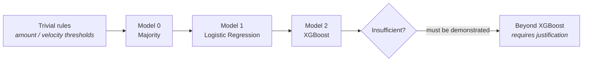

# Model Baselines & Results Ledger

**Status:** Checkpoint 0 — specification. Models are implemented in Checkpoint 2.
All result cells read `Not yet measured.`
**Owner:** ML Agent (see `AGENTS.md`)

**Purpose.** Define the baseline ladder, the preprocessing each rung requires, the
selection criteria, and the ledger where measured results will be recorded.

---

## 1. Why baselines come first

Without a floor, a metric is uninterpretable. "PR-AUC 0.7" means nothing until you
know what trivial approaches achieve on the same data.

The clearest illustration is the majority classifier. At the primary synthetic
benchmark configuration of 5% fraud prevalence, predicting "never fraud" for every
transaction yields **95% accuracy while catching zero fraud**. That single fact is
why accuracy is rejected as the primary metric throughout this project, and why
Model 0 exists: it makes the degenerate solution visible in the ledger rather than
leaving it as a footnote.

Baselines also protect against the opposite error — celebrating a complex model
that a one-line rule matches. The trivial rules from the readiness audit are
therefore carried forward as permanent reference points.

---

## 2. The baseline ladder



### Reference rules (from the readiness audit)

Not models, but essential context. Both are expected to be **weak**; if either is
strong, the dataset is leaking its label and the generator must be fixed (see
`docs/ML_READINESS.md` §3).

| Rule | Definition | Purpose |
|---|---|---|
| Large-amount rule | Flag if `transaction_amount` exceeds a fixed threshold | Confirms "large amount ⇒ fraud" is not universally true |
| High-velocity rule | Flag if `tx_velocity_1h` exceeds a fixed threshold | Confirms "many transactions ⇒ fraud" is not universally true |

### MODEL 0 — Majority classifier

**Purpose.** Establish the absolute floor and expose accuracy's uselessness under
imbalance.
**Inputs.** None (predicts the majority class).
**Preprocessing.** None.
**Establishes.** The accuracy a model must be *ignored* for achieving; the
zero-recall reference point; the cost of catching nothing (`FN × FN_COST` for all
fraud).
**Interpretability.** Total — it does one thing.

### MODEL 1 — Logistic Regression

**Purpose.** A genuine but linear baseline. Establishes how much of the signal is
linearly separable in the feature space.
**Inputs.** Full point-in-time feature matrix (see `docs/FEATURE_REFERENCE.md`).
**Preprocessing.** **Scaling required** — coefficients and convergence depend on
feature scale, and raw amounts vs counts differ by orders of magnitude. Scaler fit
on TRAIN only. Class imbalance addressed via class weighting.
**Key config.** Regularisation strength and penalty, solver, class weighting,
max iterations.
**Establishes.** A calibrated, inspectable reference. Coefficients give directional
interpretability that is genuinely useful for explaining alerts.
**Interpretability.** High — signed per-feature coefficients.
**Anticipated failure mode.** Misses interactions. Fraud signal is frequently
conjunctive ("new device **and** unusual geography **and** elevated velocity"); a
linear model cannot represent that without explicit interaction terms.

### MODEL 2 — XGBoost

**Purpose.** The strong tabular baseline; the transaction-level ceiling this
project measures the graph layer against.
**Inputs.** Full point-in-time feature matrix. Raw (unscaled) features are fine.
**Preprocessing.** No scaling needed (trees are scale-invariant). Any imputation
or encoding still fit on TRAIN only.
**Key config.** `scale_pos_weight` (see §4), `n_estimators`, `max_depth`,
`learning_rate`, `subsample`, `colsample_bytree`, regularisation terms, early
stopping on **validation**.
**Establishes.** How well non-linear per-transaction modelling can do. Feature
importances and per-prediction attributions feed the explainability engine.
**Interpretability.** Moderate — global importances plus per-prediction
attribution.
**Anticipated failure mode.** The important one for this project: **XGBoost cannot
see relational structure, because coordinated abuse is not encoded in
per-transaction features at all.** No amount of boosting recovers a signal that is
absent from the input representation. A fake merchant ring in which every
transaction is individually plausible presents XGBoost with rows that genuinely
look normal. This is a limitation of the *feature space*, not of the algorithm —
and it is precisely the gap the graph layer targets.

### Beyond XGBoost

Deep learning and graph neural networks are **out of scope** unless the simpler
approach is first implemented, evaluated, and *measured* as insufficient. See §7.

---

## 3. Preprocessing requirements

| Model | Scaling | Imputation | Encoding | Fit on |
|---|---|---|---|---|
| Majority | not required | not required | not required | n/a |
| Logistic Regression | **required** | explicit cold-start defaults | as needed | TRAIN only |
| XGBoost | not required | explicit cold-start defaults | as needed | TRAIN only |

Cold-start handling is done in the feature layer with documented defaults, not by
a generic imputer, so the semantics are visible (see `docs/FEATURE_REFERENCE.md`
§4). Fitted preprocessing artifacts are saved to `artifacts/preprocessing/` and
referenced from the experiment record.

---

## 4. `scale_pos_weight`

For XGBoost, the standard imbalance correction:

```
scale_pos_weight = (# negative examples in TRAIN) / (# positive examples in TRAIN)
```

Computed from the **TRAIN split only** — using validation or test counts would leak
their class distribution into training. The value is data-dependent and varies with
the configured prevalence.

| Prevalence config | `scale_pos_weight` |
|---|---|
| 1% | Not yet measured. |
| 5% (primary) | Not yet measured. |
| 10% | Not yet measured. |
| 25% | Not yet measured. |

---

## 5. Results ledger

Metric definitions in `EVALUATION.md`. Threshold selected on validation by
minimising Total Error Cost under the primary cost configuration
(`FP_COST = 15`, `FN_COST = 450`).

### 5.1 VALIDATION split

| Model | PR-AUC | Precision | Recall | F1 | ROC-AUC | FP | FN | FPR | FNR | Total Error Cost | Threshold |
|---|---|---|---|---|---|---|---|---|---|---|---|
| Large-amount rule | Not yet measured. | Not yet measured. | Not yet measured. | Not yet measured. | Not yet measured. | Not yet measured. | Not yet measured. | Not yet measured. | Not yet measured. | Not yet measured. | Not yet measured. |
| High-velocity rule | Not yet measured. | Not yet measured. | Not yet measured. | Not yet measured. | Not yet measured. | Not yet measured. | Not yet measured. | Not yet measured. | Not yet measured. | Not yet measured. |
| Model 0 — Majority | Not yet measured. | Not yet measured. | Not yet measured. | Not yet measured. | Not yet measured. | Not yet measured. | Not yet measured. | Not yet measured. | Not yet measured. | Not yet measured. | Not yet measured. |
| Model 1 — Logistic Regression | Not yet measured. | Not yet measured. | Not yet measured. | Not yet measured. | Not yet measured. | Not yet measured. | Not yet measured. | Not yet measured. | Not yet measured. | Not yet measured. | Not yet measured. |
| Model 2 — XGBoost | Not yet measured. | Not yet measured. | Not yet measured. | Not yet measured. | Not yet measured. | Not yet measured. | Not yet measured. | Not yet measured. | Not yet measured. | Not yet measured. | Not yet measured. |

### 5.2 HELDOUT TEST split — 🔒 SEALED

> **Do not fill this table before Checkpoint 6.** The held-out set is opened
> exactly once, after all training, tuning, threshold selection, and model
> selection are complete and frozen. See `docs/DATA_SPLIT_PROTOCOL.md`.

| Model | PR-AUC | Precision | Recall | F1 | ROC-AUC | FP | FN | FPR | FNR | Total Error Cost | Threshold |
|---|---|---|---|---|---|---|---|---|---|---|---|
| Model 0 — Majority | Not yet measured. | Not yet measured. | Not yet measured. | Not yet measured. | Not yet measured. | Not yet measured. | Not yet measured. | Not yet measured. | Not yet measured. | Not yet measured. | Not yet measured. |
| Model 1 — Logistic Regression | Not yet measured. | Not yet measured. | Not yet measured. | Not yet measured. | Not yet measured. | Not yet measured. | Not yet measured. | Not yet measured. | Not yet measured. | Not yet measured. | Not yet measured. |
| Model 2 — XGBoost | Not yet measured. | Not yet measured. | Not yet measured. | Not yet measured. | Not yet measured. | Not yet measured. | Not yet measured. | Not yet measured. | Not yet measured. | Not yet measured. | Not yet measured. |

---

## 6. Model selection criteria

Selection happens on the **validation** split, in this order:

1. **Total Error Cost** under the primary cost configuration — the operational
   objective.
2. **PR-AUC** — threshold-independent ranking quality, guarding against a lucky
   threshold.
3. **Stability across cost configurations** — a model that wins under 15/450,
   15/1000, and 50/450 is preferred over one that wins only under one.
4. **Tiebreakers:** interpretability (explanations must be defensible to an
   analyst) and inference latency.

**We do not force transaction-level ML to look good.** If XGBoost underperforms on
coordinated abuse, that result is reported prominently rather than engineered away.
Discovering the limits of per-transaction modelling is a stated goal of the project
(see `PRD.md` §1), not an embarrassment. A tuned model that handles individual
anomalies well and rings poorly is the finding the ablation study exists to
document.

---

## 7. Escalation policy

The standing rule: **complexity must be earned by measurement.**

Moving beyond XGBoost requires all of the following to be documented first:

1. XGBoost is fully implemented, tuned within a declared budget, and evaluated.
2. Its failure mode is characterised — specifically, whether the failure is in the
   *algorithm* or in the *feature representation*.
3. The simpler remedy has been tried. If the failure is representational (as
   anticipated for coordinated abuse), the correct response is **better features
   or the graph layer**, not a bigger model. Adding a neural network to the same
   feature matrix that lacks relational information will not help.
4. A specific hypothesis explains why the more complex approach would address the
   measured gap.

Concretely: graph neural networks are not considered until the NetworkX-based
graph approach of Checkpoint 3 is implemented, evaluated, and shown insufficient.
Neo4j is not considered until NetworkX is shown insufficient. Deep learning is not
used for tabular baselines at all.

---

## 8. Anticipated failure modes summary

| Model | Expected weakness | Which attack families likely evade it |
|---|---|---|
| Trivial rules | No context; no notion of "unusual *for this account*" | Nearly all |
| Model 0 — Majority | Catches nothing by construction | All |
| Model 1 — Logistic Regression | No feature interactions | Account takeover (conjunctive signals), coordinated abuse |
| Model 2 — XGBoost | Blind to relationships between entities | Fake merchant ring, shared device ring, circular money flow, synthetic identity cluster, coordinated microtransactions |

The final column is the project's thesis in tabular form: the attack families
listed against XGBoost are exactly Class B (coordinated abuse) from `PRD.md` §4,
and they are the target of the graph intelligence layer.

---

## Related documents

- `EVALUATION.md` — metric definitions, evaluation levels
- `docs/COST_MODEL.md` — cost configurations and threshold selection
- `docs/DATA_SPLIT_PROTOCOL.md` — split permissions and the sealed held-out set
- `docs/EXPERIMENT_PROTOCOL.md` — reproducibility and the ablation study
- `docs/FEATURE_REFERENCE.md` — feature catalogue and cold-start policy
- `docs/ML_READINESS.md` — trivial-rule audit
- `MODEL_CARD.md` — intended use and limitations
